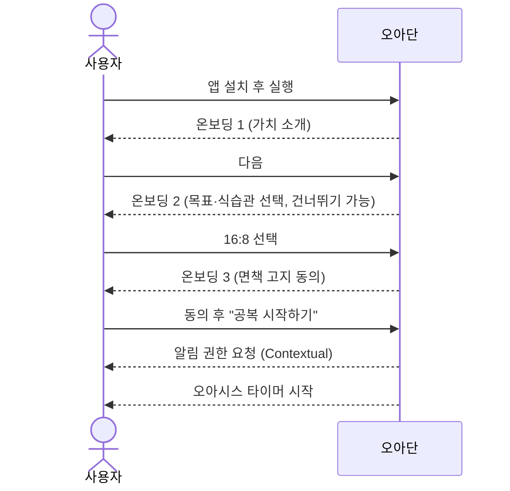
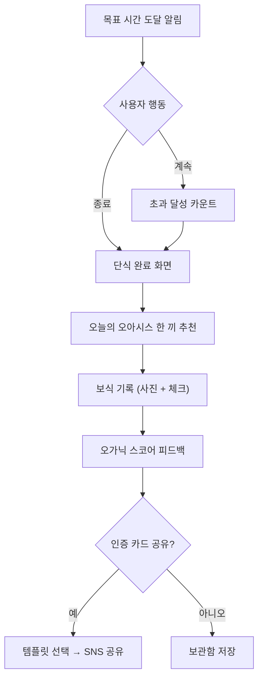

# 오아단 (OADAN) 서비스 기획 문서

> **문서 버전:** v1.0 (2026-11-10)
> **참조 문서:** [code_artifact.md](../code_artifact.md) — 간헐적 단식 앱 요구사항 명세서(SRS)
> **연계 문서:** [02_OADAN_디자인가이드.md](./02_OADAN_디자인가이드.md)

---

## 1. 서비스 개요

### 1.1 한 줄 정의
> **"공복은 사막이 아니라, 나를 쉬게 하는 오아시스."**
> 오아단은 간헐적 단식 타이머와 **단식 후 첫 끼(보식)를 자연식·유기농 식단으로 안내하는 '오가닉 식단 가이드'** 를 결합한 웰니스 단식 앱입니다.

### 1.2 네이밍
| 항목 | 내용 |
| :--- | :--- |
| 국문명 | 오아단 |
| 영문명 | OADAN |
| 어원 ① | **O**rganic + **A**름다운 + **단**식 |
| 어원 ② | **오아**시스(Oasis) + **단**식 — 공복이라는 사막 속의 휴식처 |
| 네이밍 강점 | '간단', '인아웃'처럼 3음절로 입에 붙고, `#오아단` `#오아단인증` 해시태그 확산에 유리 |
| 슬로건(안) | 메인: **"비우고, 채우는 오아시스"** / 서브: "오늘의 공복, 오아단에서 쉬어가요" |

### 1.3 기획 배경
1. **시장 상황:** 플레이스토어 상위 단식 앱은 대부분 '타이머 + 기록' 중심으로 기능이 상향 평준화되어 있어 차별점이 부족합니다.
2. **사용자 Pain Point**
   - 단식 자체보다 **"단식 후 무엇을 어떻게 먹어야 하는가"** 에서 실패(폭식, 혈당 스파이크)가 많이 발생함
   - 숫자·경고 중심 UI는 단식을 '참는 고통'으로 인식하게 만들어 이탈을 유발함
   - 기록은 하지만 **공유하고 싶은 결과물**이 없어 바이럴이 약함
3. **기회 요인:** 클린 이팅, 저속노화, 혈당 관리 트렌드 확산 → '보식(Break-fast)'을 전면에 내세운 앱은 아직 드묾

### 1.4 차별화 포인트 (USP)
| # | USP | 설명 |
| :--- | :--- | :--- |
| 1 | **오가닉 보식 가이드** | 단식 시간·대사 단계에 맞춘 한국형 자연식 첫 끼 추천 + 기록 + 혈당 친화도 피드백 |
| 2 | **힐링형 공복 경험** | 사막 → 오아시스로 변해가는 비주얼 타이머로 '참는 시간'을 '채워지는 시간'으로 재해석 |
| 3 | **공유하고 싶은 인증 카드** | 단식 완료 + 보식 사진을 감성 카드로 자동 생성, `#오아단인증` 원탭 공유 |
| 4 | **완전 무료 · 무광고 · 무가입** | 결제·광고 없이 모든 기능 제공, 설치 직후 3탭 안에 첫 단식 시작, 오프라인 완전 지원 (SRS NFR-04, 05) |

---

## 2. 타깃 사용자

### 2.1 핵심 타깃
- **연령:** 25~39세 (2차: 40~54세 건강관리층)
- **특징:** 다이어트보다는 **컨디션·피부·혈당·저속노화**에 관심, SNS 기록·인증 문화에 익숙

### 2.2 페르소나
| 구분 | 페르소나 A — "클린 루틴러" | 페르소나 B — "혈당 관리 직장인" | 페르소나 C — "재도전러" |
| :--- | :--- | :--- | :--- |
| 프로필 | 29세 여성, 마케터 | 41세 남성, IT 기업 팀장 | 34세 여성, 육아 휴직 후 복직 |
| 목표 | 피부·붓기 관리, 건강한 식습관 | 공복혈당·뱃살 관리 | 3kg 감량, 꾸준함 회복 |
| Pain Point | 단식 후 빵·떡볶이로 폭식 | 회식 등 불규칙한 일정 | 과거 앱 사용 시 3일 만에 포기 |
| 오아단 가치 | 예쁜 보식 기록과 인증 카드 | 요일별 스케줄, 시간 소급 수정, 헬스 커넥트 연동 | 포기 방어 모달, 스트릭 세이버, 따뜻한 톤의 응원 |

---

## 3. 서비스 구조

### 3.1 핵심 사용자 여정 (Core Loop)

### 3.2 정보 구조 (IA)

```mermaid
flowchart TD
    ROOT["오아단 앱"] --> T1["홈(타이머)"]
    ROOT --> T2["보식"]
    ROOT --> T3["기록"]
    ROOT --> T4["리포트"]
    ROOT --> T5["마이"]

    T1 --> T1a["오아시스 타이머"]
    T1 --> T1b["대사 단계 타임라인"]
    T1 --> T1c["수분 원터치 기록"]
    T1 --> T1d["시작/종료 시간 수정"]

    T2 --> T2a["오늘의 보식 추천"]
    T2 --> T2b["보식 레시피 상세"]
    T2 --> T2c["보식 기록(사진/AI 분석)"]
    T2 --> T2d["오가닉 장보기 리스트"]

    T3 --> T3a["체중·체성분"]
    T3 --> T3b["컨디션 태그/메모"]
    T3 --> T3c["눈바디 갤러리"]

    T4 --> T4a["주간/월간 캘린더"]
    T4 --> T4b["단식시간·체중 이중축 그래프"]
    T4 --> T4c["스트릭·배지"]
    T4 --> T4d["인증 카드 보관함"]

    T5 --> T5a["단식 플랜·요일 스케줄"]
    T5 --> T5b["알림 설정"]
    T5 --> T5c["계정·백업·데이터 삭제"]
    T5 --> T5d["위젯·워치·헬스커넥트"]
    T5 --> T5e["면책 고지·도움말"]
```

### 3.3 하단 내비게이션
| 순서 | 탭 | 아이콘 컨셉 | 비고 |
| :---: | :--- | :--- | :--- |
| 1 | 홈 | 오아시스 물방울 | 앱 진입 기본 탭 |
| 2 | 보식 | 새싹 그릇 | **핵심 차별화 탭**, 단식 종료 직후 배지(●) 강조 |
| 3 | 기록 | 연필 + 잎 | 체중/컨디션/눈바디 |
| 4 | 리포트 | 막대 그래프 | 통계·스트릭 |
| 5 | 마이 | 사람 | 설정 |

---

## 4. 기능 명세

> SRS의 FR ID를 그대로 승계하고, 오아단 고유 기능은 `OA-` 접두어로 신규 정의합니다.

### 4.1 기능 목록 및 우선순위

| ID | 기능명 | 오아단 적용 방향 | 우선순위 | 릴리스 |
| :--- | :--- | :--- | :---: | :---: |
| FR-01 | 프로토콜 설정 | 프리셋 카드에 '추천 보식 강도' 함께 표시 (예: 18:6 → 부드러운 보식 권장) | 상 | MVP |
| FR-02 | 실시간 트래킹 | **오아시스 타이머**(원형 링 + 사막→오아시스 일러스트 변화), 초과 달성 시 '보너스 오아시스' 연출 | 상 | MVP |
| FR-03 | 대사 단계 타임라인 | 5단계를 '모래 → 바람 → 샘물 → 야자수 → 오아시스' 메타포로 시각화 | 상 | MVP |
| FR-04 | 멀티 트래킹 | 수분은 '오아시스 물 채우기' 인터랙션, 보식 기록은 보식 탭으로 연결 | 상 | MVP |
| FR-05 | 스마트 푸시·포기 방어 | 방어 모달 문구를 따뜻한 톤으로 ("샘물이 거의 다 찼어요, 1시간만 더 쉬어갈까요?") | 상 | MVP |
| **OA-01** | **오가닉 보식 추천** | 단식 시간·대사 단계·사용자 선호 기반 첫 끼 3종 추천 | **상** | **MVP** |
| **OA-02** | **보식 기록 & 오가닉 스코어** | 사진/텍스트 기록 + 자연식 비율·혈당 친화도 기반 점수 | **상** | **MVP** |
| **OA-03** | **#오아단인증 카드** | 단식 결과 + 보식 사진 합성 카드 자동 생성, SNS 공유 | **상** | **MVP** |
| FR-06 | 대시보드·스트릭 | 스트릭을 '오아시스 정원'으로 시각화(연속일수만큼 식물 성장), 월 2회 세이버 | 중 | v1.1 |
| FR-07 | 위젯·상단바·워치 | 위젯에 오아시스 링 + 대사 단계 아이콘, 워치 타일에서 수분 추가 | 중 | v1.1 |
| **OA-04** | **오가닉 장보기 리스트** | 추천 보식 레시피 재료를 체크리스트로 저장 | 중 | v1.1 |
| **OA-05** | **보식 챌린지** | "7일 오가닉 보식 챌린지" 등 기간형 미션 + 완주 배지 | 중 | v1.2 |
| FR-08 | AI 식단 분석·헬스 연동 | 사진 분석으로 칼로리·탄단지 + **가공도(NOVA 분류) 추정**, 혈당 스파이크 위험도 | 하 | v2.0 |
| **OA-06** | **커뮤니티 피드** | `#오아단인증` 피드, 좋아요·저장, 보식 레시피 공유 | 하 | v2.0 |

### 4.2 [OA-01] 오가닉 보식 추천 — 상세

**목적:** 단식 종료 직후 폭식·혈당 스파이크를 막고, 자연식 첫 끼 습관을 형성

**추천 로직 (Rule-based MVP)**

| 직전 단식 시간 | 보식 단계 | 권장 구성 | 예시 메뉴 |
| :--- | :--- | :--- | :--- |
| ~14시간 | 일반 보식 | 균형 한 끼, 정제 탄수화물 최소화 | 현미밥 + 된장국 + 나물 3종 + 두부구이 |
| 14~18시간 | 부드러운 보식 | 식이섬유 → 단백질 → 탄수화물 순서 섭취 | 샐러드 → 달걀/닭가슴살 → 고구마 반 개 |
| 18~24시간 | 순한 보식 | 소화가 쉬운 따뜻한 음식, 소량 | 채소죽, 맑은 미역국, 연두부 |
| 24시간 이상 | 회복 보식 (2단계) | 1단계 맑은 국물·발효식 → 30~60분 후 2단계 일반식 | 1단계: 사골·채수, 플레인 요거트 / 2단계: 현미죽 + 흰살생선 |

- **필터:** 비건 / 락토오보 / 글루텐프리 / 저탄수 / 알레르기(견과·갑각류·유제품 등)
- **보조 정보:** 추천 카드마다 `먹는 순서 가이드`, `조리 시간`, `혈당 친화도(낮음/보통/높음)` 표시
- **연결 동선:** 단식 종료 → 완료 축하 화면 → **"오늘의 오아시스 한 끼 보기"** CTA → 보식 탭
- **고도화(v2.0):** 사용자의 과거 보식 기록, 컨디션 태그, 계절 제철 재료 기반 개인화 추천

### 4.3 [OA-02] 보식 기록 & 오가닉 스코어 — 상세

| 항목 | 내용 |
| :--- | :--- |
| 입력 방식 | 사진 촬영/앨범 선택, 추천 메뉴 원탭 기록, 텍스트 직접 입력 |
| 체크 항목 | ☐ 채소 먼저 먹었어요 ☐ 가공식품 없어요 ☐ 천천히 20분 이상 ☐ 단 음료 없어요 ☐ 제철 재료 |
| 오가닉 스코어 | 체크 항목 + 메뉴 태그 기반 0~100점 → 3등급(🌱 새싹 / 🌿 잎새 / 🌳 오아시스) |
| 피드백 | 점수 대신 **긍정 문구 중심** ("채소를 먼저 드셨네요! 혈당이 천천히 오를 거예요") |
| 금지 사항 | 칼로리 과소 섭취 유도, 부정적 평가("나쁜 음식") 문구 사용 금지 — 섭식장애 유발 방지 |

### 4.4 [OA-03] #오아단인증 카드 — 상세
- **자동 생성 시점:** 단식 완료 + 보식 기록 저장 시
- **카드 구성:** 단식 시간(예: `18h 24m`), 도달 대사 단계 아이콘, 보식 사진, 오가닉 스코어 등급, 스트릭 일수, 로고 워터마크 `#오아단인증`
- **템플릿:** 3종(사진형 / 미니멀 텍스트형 / 오아시스 일러스트형), 비율 1:1 · 9:16(스토리)
- **공유:** Android Sharesheet(인스타그램 스토리, 카카오톡, 스레드 등) + 해시태그 자동 클립보드 복사
- **개인정보:** 체중 정보는 기본 **비노출**, 사용자가 토글로 선택 시에만 표기

### 4.5 MVP 범위 요약
- **포함:** FR-01~05, OA-01~03, NFR 전 항목, 무가입 온보딩, 로컬 DB, 면책 고지
- **제외:** 소셜 로그인 서버 동기화(로컬 백업 파일로 대체), AI 사진 분석, 워치, 커뮤니티

---

## 5. 주요 화면 목록 (Screen List)

| 화면 ID | 화면명 | 주요 요소 | 관련 기능 |
| :--- | :--- | :--- | :--- |
| SC-00 | 스플래시 | 로고 모션(물방울 → 오아시스) | - |
| SC-01 | 온보딩 (3단계) | ① 가치 소개 ② 목표·식습관 선택 ③ 면책 고지 동의 | NFR-05, 06 |
| SC-02 | 플랜 선택 | 프리셋 카드(14:10 ~ OMAD, 5:2, 커스텀), 요일 스케줄 | FR-01 |
| SC-10 | 홈 — 대기 상태 | 다음 단식 예정 시각, "공복 시작하기" 버튼, 최근 보식 | FR-01 |
| SC-11 | 홈 — 단식 중 | 오아시스 타이머, 현재 대사 단계, 수분 버튼, 시작 시간 수정 | FR-02~04 |
| SC-12 | 대사 단계 상세 (Bottom Sheet) | 5단계 타임라인, 과학적 근거 툴팁 | FR-03 |
| SC-13 | 포기 방어 모달 | 현재 단계 안내, 1시간 더 / 목표 단축 / 종료 | FR-05 |
| SC-14 | 단식 완료 | 축하 연출, 결과 요약, "오늘의 오아시스 한 끼" CTA | FR-02, OA-01 |
| SC-20 | 보식 홈 | 추천 3종 카드, 필터, 장보기 리스트 진입 | OA-01, 04 |
| SC-21 | 보식 레시피 상세 | 재료, 먹는 순서, 조리법, 혈당 친화도 | OA-01 |
| SC-22 | 보식 기록 | 사진, 체크 항목, 메모 → 오가닉 스코어 | OA-02 |
| SC-23 | 인증 카드 편집/공유 | 템플릿 선택, 정보 토글, 공유 | OA-03 |
| SC-30 | 기록 | 체중·체성분, 컨디션 태그, 눈바디 | FR-04 |
| SC-40 | 리포트 | 캘린더, 그래프, 스트릭(오아시스 정원), 배지 | FR-06 |
| SC-50 | 마이/설정 | 플랜, 알림, 위젯, 백업/복원, 데이터 삭제, 면책 고지 | NFR-05~07 |
| SC-51 | 72시간 초과 확인 팝업 | "단식이 아직 진행 중인가요?" + 종료 시간 수정 | SRS 체크리스트 |

---

## 6. 주요 플로우

### 6.1 첫 실행 → 첫 단식 시작 (목표: 3탭, 60초 이내)

### 6.2 단식 종료 → 보식 → 인증

### 6.3 중도 포기 방어
1. 단식 중 "종료" 탭 → 목표 미달 시 **포기 방어 모달** 노출
2. 선택지: `1시간만 더 쉬어가기` / `오늘 목표 N시간으로 줄이기` / `여기서 마무리하기`
3. '마무리' 선택 시에도 **실패가 아닌 "부분 달성"** 으로 기록하고, 순한 보식 추천으로 연결
4. 어지럼증·두통 등 컨디션 태그 선택 시 **즉시 종료 권고 + 저혈당 대처 안내** 우선 노출 (NFR-06)

---

## 7. 운영 정책 — 전면 무료 서비스

### 7.1 기본 방침
> **오아단은 유료화 계획 없이 모든 기능을 무료로 제공합니다.**

| 항목 | 정책 |
| :--- | :--- |
| 이용 요금 | 전 기능 무료 — 구독, 인앱 결제, 기능 잠금(Paywall) 없음 |
| 광고 | 미탑재 — 공복 중 집중과 힐링 경험을 해치지 않도록 광고 SDK를 넣지 않음 |
| 기능 제공 범위 | 프리셋·커스텀 플랜, 요일별 스케줄, 보식 추천 3종 + 필터, 인증 카드 전체 템플릿, 전체 기간 통계, CSV 내보내기 등 **모든 기능을 제한 없이** 제공 |
| 스토어 표기 | Play Console '인앱 구매 없음', '광고 없음'으로 등록 → 스토어 상세 페이지에서 신뢰 요소로 활용 |
| 마케팅 메시지 | **"광고 없이, 결제 없이, 오롯이 나를 위한 공복"** — 무료·무광고를 차별점으로 내세움 |

### 7.2 운영 비용 최소화 전략
무료 서비스를 오래 유지하려면 서버 비용을 최대한 낮게 유지해야 합니다.

| 영역 | 전략 |
| :--- | :--- |
| 데이터 저장 | **Local-First** (NFR-04) — 핵심 기능은 모두 기기 안에서 동작하고, 서버 없이 운영 가능 |
| 백업·동기화 | 1차: JSON/CSV 파일 백업·복원 → 2차: 사용자 본인의 Google Drive 앱 폴더 백업 (자체 서버 저장소 최소화) |
| 보식 콘텐츠 | 레시피 DB는 앱에 번들로 포함하고, 업데이트는 정적 파일(CDN) 방식으로 배포 |
| AI 사진 분석 (v2.0) | 온디바이스 모델(ML Kit / TensorFlow Lite) 우선 검토 → 클라우드 API를 쓰게 되면 사용자당 일일 분석 횟수 상한 설정 |
| 커뮤니티 (v2.0) | 운영·모더레이션 부담이 크므로 도입 전 별도 검토 (대안: SNS 해시태그 `#오아단인증` 중심 바이럴 유지) |

> [!NOTE]
> 런칭 캠페인의 '보식 키트 추첨' 등은 수익 모델이 아닌 **마케팅 이벤트**이며, 제휴를 진행하더라도 앱 안에 광고·커머스 영역은 만들지 않습니다.

---

## 8. 성공 지표 (KPI)

| 구분 | 지표 | 목표 (출시 6개월) |
| :--- | :--- | :--- |
| 활성화 | 설치 후 24시간 내 첫 단식 시작률 | 70% 이상 |
| 리텐션 | D7 / D30 리텐션 | 35% / 18% 이상 |
| 핵심 행동 | 단식 완료 후 보식 기록률 | 40% 이상 |
| 바이럴 | 인증 카드 공유율(완료 건 대비) / `#오아단` 게시물 수 | 8% / 누적 1만 건 |
| 성장 | MAU / 자연 유입(오가닉 설치) 비율 | 5만 명 / 60% 이상 |
| 품질 | 크래시 프리 세션 / 스토어 평점 | 99.7% / 4.6 이상 |

---

## 9. 출시 로드맵

| 단계 | 기간(안) | 주요 범위 |
| :--- | :--- | :--- |
| 기획·디자인 | 4주 | 기획 확정, 디자인 시스템, 핵심 화면 UI, 프로토타입 사용성 테스트(5~8명) |
| MVP 개발 | 8주 | FR-01~05, OA-01~03, 로컬 DB, 알림, 면책 고지 |
| CBT | 2주 | 50~100명 클로즈드 테스트, 타이머 정확도·배터리 검증 |
| v1.0 출시 | - | 플레이스토어 정식 출시, `#오아단인증` 런칭 이벤트 |
| v1.1 | +6주 | 스트릭/오아시스 정원, 위젯·상단바·워치, 장보기 리스트 |
| v1.2 | +6주 | 보식 챌린지, 소셜 로그인 + 클라우드 동기화 |
| v2.0 | +12주 | AI 사진 분석, Health Connect, 커뮤니티 피드, iOS |

---

## 10. 리스크 및 대응

| 리스크 | 영향 | 대응 방안 |
| :--- | :--- | :--- |
| 건강 관련 스토어 정책 위반 | 출시 지연·삭제 | 의료기기 아님 고지, 근거 출처 표기, 치료 효과 표현 금지 (NFR-06) |
| 섭식장애 유발 우려 | 브랜드 신뢰 하락 | 최소 BMI 경고, 72시간 상한, 부정적 음식 평가 금지, 과도 단식 반복 시 휴식 권고 |
| 보식 추천의 의학적 정확성 | 사용자 불만·법적 위험 | 영양사 자문 검수, "일반 정보" 고지, 질환자 전문의 상담 권고 |
| 타이머·알림 오차 | 핵심 신뢰 붕괴 | 타임스탬프 기반 계산, Exact Alarm (NFR-01~03) |
| 차별점 모방 | 경쟁력 약화 | 보식 콘텐츠 DB·인증 카드 브랜드 자산 선점, 커뮤니티 락인 |
| 상표 충돌 | 리브랜딩 비용 | 출시 전 '오아단/OADAN' 상표 출원(9류·44류) 및 도메인·SNS 계정 선점 |
| 무료 운영 지속성 | 서버 비용 증가로 서비스 유지 부담 | Local-First 구조로 서버 의존도 최소화, AI·커뮤니티 등 비용이 큰 기능은 비용 검토 후 도입 (7.2 참조) |

---

## 11. 콘텐츠 & 마케팅 가이드 (런칭)
- **해시태그 체계:** `#오아단` (브랜드) / `#오아단인증` (단식 완료) / `#오아단보식` (보식 레시피) / `#오아단챌린지` (기간 미션)
- **런칭 캠페인(안):** "7일 오아시스 챌린지" — 7일 연속 인증 시 유기농 보식 키트 추첨
- **콘텐츠 축:** 제철 보식 레시피 숏폼, 대사 단계 과학 카드뉴스, 사용자 인증 카드 리그램
