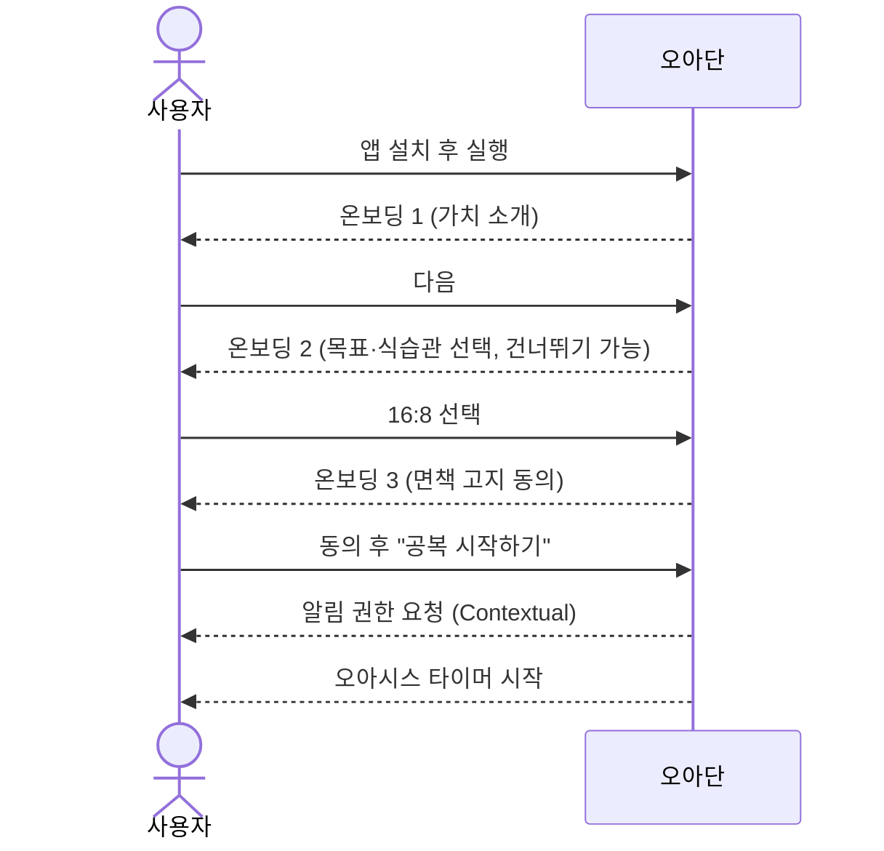
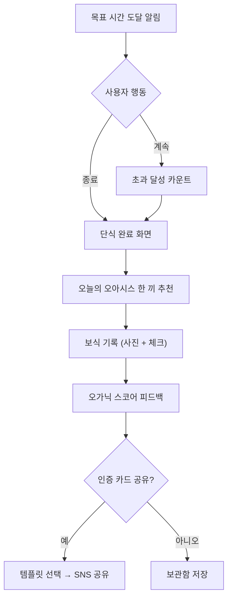
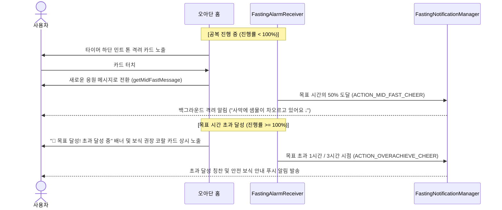
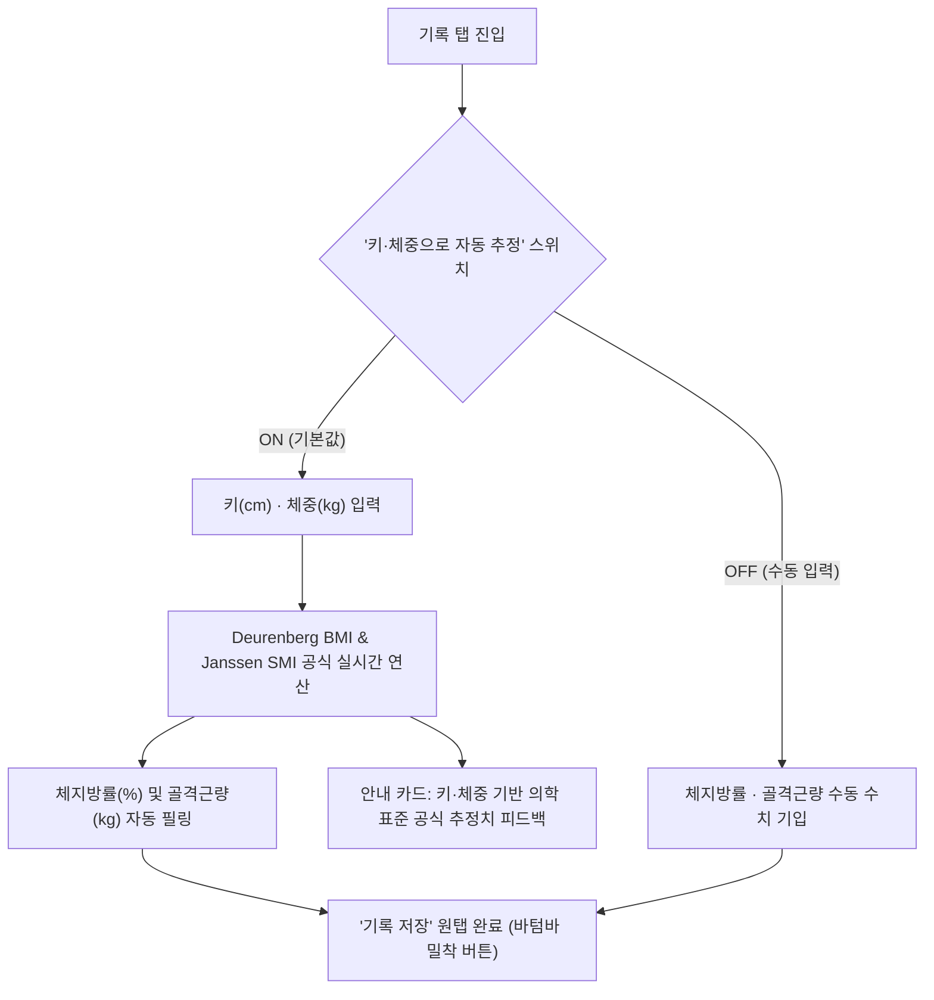
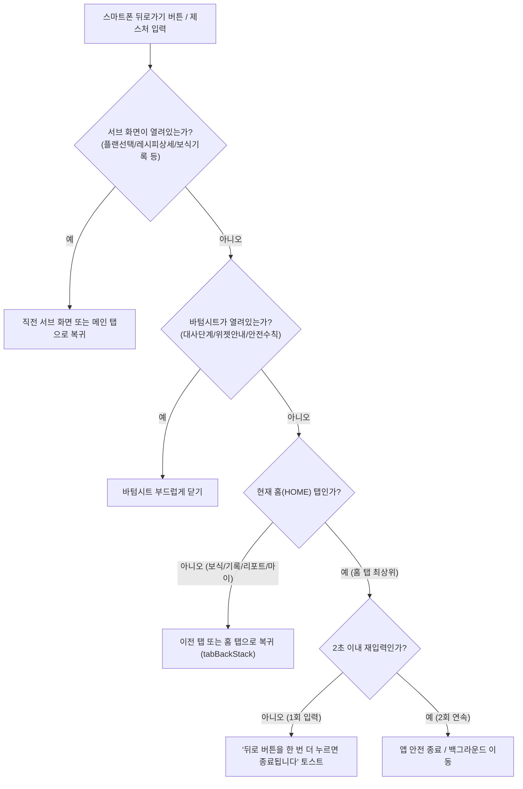

# 오아단 (OADAN) 서비스 기획 문서

> **문서 버전:** v1.5 (2026-11-12 개정)  
> **참조 문서:** [code_artifact.md](../code_artifact.md) — 간헐적 단식 앱 요구사항 명세서(SRS)  
> **연계 문서:** [02_OADAN_디자인가이드.md](./02_OADAN_디자인가이드.md), [03_OADAN_테스트계획서.md](./03_OADAN_테스트계획서.md), [04_OADAN_테스트결과보고서.md](./04_OADAN_테스트결과보고서.md)

---

### 개정 이력 (Revision History)
| 버전 | 개정일자 | 개정자 | 개정 내용 요약 |
| :---: | :---: | :---: | :--- |
| **v1.0** | 2026-11-10 | 기획팀 | 최초 서비스 기획안 수립 (SRS 연계, 오가닉 보식 및 오아시스 콘셉트 정의) |
| **v1.1** | 2026-11-10 | 기획/개발팀 | **사용자 피드백 및 MVP 기능 확장:** 1. 체성분 스마트 자동 추정([OA-08]): 키·체중 기반 체지방률·골격근량 자동 계산 알고리즘 2. 지능형 공복 응원 & 초과 달성 성취 메시지([OA-07]): 주기적 격려 및 목표 초과 달성 배너·알림 3. 홈 화면 위젯 및 핀 추가 가이드([OA-09]): 2×2 미니, 4×2 와이드 위젯 및 AppWidgetManager 핀 연동 4. 오아시스 타이머 가독성 개선: 텍스트-일러스트 중첩 해소 및 글래스모피즘 정보 컨테이너 |
| **v1.2** | 2026-11-10 | 기획/개발팀 | **UI/UX 고도화, 테마 시스템 및 시스템 내비게이션 개편:** 1. 단식 대기 화면 그래픽 개편([OA-12]): 건강한 인체 실루엣과 코어 활력 펄스 그래픽으로 전면 교체 2. 화면 테마 시스템 신설([OA-10]): 기본값 ☀️ 라이트 모드 고정, 다크 모드(Night Oasis) 및 시스템 동기화 지원, 전 화면 Dynamic Color 일원화 3. 스마트폰 시스템 뒤로가기(Back) 계층형 내비게이션 구축([OA-11]): 뒤로가기 시 서브화면/시트 닫기 → 홈 탭 복귀 → 2초 내 이중 클릭 종료 4. 레이아웃 안정화: SC-02 Scaffold bottomBar 분리, SC-11 공복 마치기/수분 1행 분리, SC-30 반응형 컨디션 칩 및 저장 버튼 밀착 5. 리포트(SC-40) 완전 구현 및 Release APK 서명 프로덕션 빌드 시스템 구축 |
| **v1.3** | 2026-11-10 | 기획/개발팀 | **단식 시간 수정 UX 리스트 선택 전면 개편 및 위젯 레이아웃 최적화:** 1. 단식 시간 리스트 수정 다이얼로그 전면 개편([OA-13]): 텍스트 직접 입력 방식(`OutlinedTextField`) 완전 제거, 빠른 프리셋 칩 및 드롭다운 리스트 도입 2. 위젯 안내 가이드(SC-52) 및 4×2 위젯 레이아웃 최적화: 종료 시간과 액션 버튼 상하 분리 배치로 '공복 마치기' 글자 왜곡 차단 |
| **v1.4** | 2026-11-11 | 기획/개발팀 | **알림 센터(알림함) 신설 및 헤더·버튼 UX 시인성 전면 개선([OA-14]):** 1. **알림 목록(NotificationListScreen) 화면 신설**: 홈 우측 상단 종 모양(🔔) 아이콘 클릭 시 공복 리듬 선택 화면으로 이동하던 UX 오류를 바로잡아, 수신된 알림 타임라인 조회 화면으로 정상 연동 2. **미확인 알림 뱃지(Dot) 및 관리 기능**: 읽지 않은 알림 주황색 점 표시, 개별 삭제, 전체 읽음, 전체 삭제 및 알림 설정 다이얼로그 연동 3. **공복 리듬(플랜) 선택 진입점 정상 분리**: 홈 상단 날짜 영역 옆에 `플랜 변경 ▾` 터치 칩을 명시하여 직관적인 플랜 설정 동선 구축 4. **'공복 마치기' 버튼 시인성 강화**: 브랜드 3차 컬러인 **선셋 코랄(`SunsetCoral #E8875B`) 솔리드 + 흰색 텍스트**로 변경하여 즉각적인 시인성과 조작성 확보 |
| **v1.5** | 2026-11-12 | 기획/개발팀 | **리포트 캘린더 기록 수정·추가·삭제 및 라이프로그 통합 관리([OA-15]):** 1. **리포트(SC-40) 단식 기록 직접 수정/추가/삭제 구축**: 캘린더에서 특정 날짜 터치 시, 단식 기록이 없는 날에도 `+ 이 날의 단식 기록 추가하기`를 통해 과거 단식을 소급 등록할 수 있고, 기존 단식 기록은 시작/종료 일시, 목표 플랜을 드롭다운 리스트로 정밀 수정하거나 삭제할 수 있도록 지원 2. **수분 섭취량 및 체중/컨디션 리포트 현장 수정**: 선택된 날짜 상세 카드에서 `수분 섭취` 및 `기록된 체중`의 `수정 ✏️` 버튼을 탭하여 해당 날짜의 수분 섭취량(ml 빠른 선택 및 미세 조정), 체중(kg), 컨디션 이모지, 메모를 즉시 수정·저장 가능 3. **실시간 리포트 동기화**: 단식 수정/추가/삭제 시 캘린더 달성(오아시스 틸)/부분 달성(민트 틸100)/휴식(점선) 서클 및 상단 평균 공복 시간, 7일 추이 차트 즉시 자동 재계산 및 렌더링 동기화 |

---

## 1. 서비스 개요

### 1.1 한 줄 정의
> **"공복은 사막이 아니라, 나를 쉬게 하는 오아시스."**
> 오아단은 간헐적 단식 타이머와 **단식 후 첫 끼(보식)를 자연식·유기농 식단으로 안내하는 '오가닉 식단 가이드'** 를 결합한 웰니스 단식 앱입니다.

### 1.2 네이밍
| 항목 | 내용 |
| :--- | :--- |
| 국문명 | 오아단 |
| 영문명 | OADAN |
| 어원 ① | **O**rganic + **A**름다운 + **단**식 |
| 어원 ② | **오아**시스(Oasis) + **단**식 — 공복이라는 사막 속의 휴식처 |
| 네이밍 강점 | '간단', '인아웃'처럼 3음절로 입에 붙고, `#오아단` `#오아단인증` 해시태그 확산에 유리 |
| 슬로건(안) | 메인: **"비우고, 채우는 오아시스"** / 서브: "오늘의 공복, 오아단에서 쉬어가요" |

### 1.3 기획 배경
1. **시장 상황:** 플레이스토어 상위 단식 앱은 대부분 '타이머 + 기록' 중심으로 기능이 상향 평준화되어 있어 차별점이 부족합니다.
2. **사용자 Pain Point**
   - 단식 자체보다 **"단식 후 무엇을 어떻게 먹어야 하는가"** 에서 실패(폭식, 혈당 스파이크)가 많이 발생함
   - 숫자·경고 중심 UI는 단식을 '참는 고통'으로 인식하게 만들어 이탈을 유발함
   - 인바디 기기가 없는 대다수 사용자는 골격근량과 체지방률을 몰라 체계적인 신체 기록을 포기함
   - 공복 중 고립감과 목표 시간 초과 시 어떻게 해야 할지(무리한 연장 혹은 폭식 위험) 안내가 부족함
   - 기록은 하지만 **공유하고 싶은 결과물**이 없어 바이럴이 약함
3. **기회 요인:** 클린 이팅, 저속노화, 혈당 관리 트렌드 확산 → '보식(Break-fast)' 및 '온화한 동기부여'를 전면에 내세운 앱은 아직 드묾

### 1.4 차별화 포인트 (USP)
| # | USP | 설명 |
| :--- | :--- | :--- |
| 1 | **오가닉 보식 가이드** | 단식 시간·대사 단계에 맞춘 한국형 자연식 첫 끼 추천 + 기록 + 혈당 친화도 피드백 |
| 2 | **힐링형 공복 경험 & 실시간 응원** | 사막 → 오아시스로 변해가는 비주얼 타이머 + 공복 진행 중 격려 및 목표 초과 달성 축하/안전 보식 안내 |
| 3 | **스마트 체성분 간편 추정** | 체성분계 없이도 키와 체중만으로 체지방률·골격근량을 의학 표준 수식으로 자동 산출 및 체형 시각화 |
| 4 | **홈 화면 위젯 & 즉시 핀 고정** | 앱을 켜지 않고도 배경화면에서 단식 진행도와 대사 단계를 확인하고 수분을 바로 기록 |
| 5 | **공유하고 싶은 인증 카드** | 단식 완료 + 보식 사진을 감성 카드로 자동 생성, `#오아단인증` 원탭 공유 |
| 6 | **완전 무료 · 무광고 · 무가입** | 결제·광고 없이 모든 기능 제공, 설치 직후 3탭 안에 첫 단식 시작, 오프라인 완전 지원 (SRS NFR-04, 05) |

---

## 2. 타깃 사용자

### 2.1 핵심 타깃
- **연령:** 25~39세 (2차: 40~54세 건강관리층)
- **특징:** 다이어트보다는 **컨디션·피부·혈당·저속노화**에 관심, SNS 기록·인증 문화에 익숙

### 2.2 페르소나
| 구분 | 페르소나 A — "클린 루틴러" | 페르소나 B — "혈당 관리 직장인" | 페르소나 C — "재도전러" |
| :--- | :--- | :--- | :--- |
| 프로필 | 29세 여성, 마케터 | 41세 남성, IT 기업 팀장 | 34세 여성, 육아 휴직 후 복직 |
| 목표 | 피부·붓기 관리, 건강한 식습관 | 공복혈당·뱃살 관리 | 3kg 감량, 꾸준함 회복 |
| Pain Point | 단식 후 빵·떡볶이로 폭식 | 회식 등 불규칙한 일정 | 과거 앱 사용 시 3일 만에 포기 |
| 오아단 가치 | 예쁜 보식 기록과 인증 카드 | 요일별 스케줄, 시간 소급 수정, 헬스 커넥트 연동 | 포기 방어 모달, 스트릭 세이버, 따뜻한 톤의 응원 |

---

## 3. 서비스 구조

### 3.1 핵심 사용자 여정 (Core Loop)

### 3.2 정보 구조 (IA)

```mermaid
flowchart TD
    ROOT["오아단 앱"] --> T1["홈(타이머)"]
    ROOT --> T2["보식"]
    ROOT --> T3["기록"]
    ROOT --> T4["리포트"]
    ROOT --> T5["마이"]

    T1 --> T1a["오아시스 타이머 (사막→오아시스 / 다크모드 나이트 오아시스 연동)"]
    T1 --> T1b["대사 단계 타임라인 (과학적 근거 바텀시트)"]
    T1 --> T1c["수분 원터치 기록 (독립 FAB 버튼)"]
    T1 --> T1d["시작/종료 시간 소급 수정 다이얼로그"]
    T1 --> T1e["공복 진행 중 격려 카드 (탭 리프레시)"]
    T1 --> T1f["목표 초과 달성 축하 & 보식 배너"]
    T1 --> T1g["단식 대기 웰니스 인체 실루엣 & 코어 활력 그래픽"]
    T1 --> T1h["알림 센터 (알림 목록 타임라인 & 설정)"]

    T2 --> T2a["오늘의 보식 추천 (단식 시간별 4단계)"]
    T2 --> T2b["보식 레시피 상세 (먹는 순서/재료/조리법)"]
    T2 --> T2c["보식 기록(사진/5대 자연식 체크)"]
    T2 --> T2d["오가닉 장보기 리스트"]

    T3 --> T3a["체중·체성분 기록"]
    T3 --> T3b["키·체중 기반 Deurenberg 체성분 자동 추정"]
    T3 --> T3c["건강 체형 실루엣 시각화"]
    T3 --> T3d["반응형 컨디션 태그(1행 균등 배치)/메모"]
    T3 --> T3e["하단 저장 버튼 12dp 밀착 배치"]

    T4 --> T4a["주간/월간 인터랙티브 캘린더"]
    T4 --> T4b["일자별 상세 기록 뷰 (단식/수분/컨디션)"]
    T4 --> T4c["단식시간 막대 & 체중 선 복합 그래프"]
    T4 --> T4d["스트릭·세이버(2회)·배지"]

    T5 --> T5a["단식 플랜·요일 스케줄"]
    T5 --> T5b["알림 설정 (단식/응원·초과/수분)"]
    T5 --> T5c["화면 테마 설정 (라이트 / 다크 / 시스템 동기화)"]
    T5 --> T5d["홈 화면 위젯 설정 안내 (2×2, 4×2 핀 추가)"]
    T5 --> T5e["계정·백업·데이터 삭제 (JSON 로컬 이관)"]
    T5 --> T5f["면책 고지·도움말"]
```

### 3.3 하단 내비게이션
| 순서 | 탭 | 아이콘 컨셉 | 비고 |
| :---: | :--- | :--- | :--- |
| 1 | 홈 | 오아시스 물방울 | 앱 진입 기본 탭 (단식 대기 시 웰니스 인체 실루엣 / 단식 중 오아시스 타이머 + 진행 중 응원 카드) |
| 2 | 보식 | 새싹 그릇 | **핵심 차별화 탭**, 단식 종료 직후 배지(●) 강조 |
| 3 | 기록 | 연필 + 잎 | 체중/체성분(자동 추정)/반응형 컨디션 태그/메모/최근 기록 내역 |
| 4 | 리포트 | 막대 그래프 | 주간·월간 캘린더 / 스트릭 & 세이버 / 상세 기록 / 단식·체중 복합 차트 |
| 5 | 마이 | 사람 | 설정 (화면 테마 모드 지정, 위젯 설치 안내, 알림 토글, JSON 백업) |

---

## 4. 기능 명세

> SRS의 FR ID를 그대로 승계하고, 오아단 고유 기능은 `OA-` 접두어로 정의합니다.

### 4.1 기능 목록 및 우선순위

| ID | 기능명 | 오아단 적용 방향 | 우선순위 | 릴리스 |
| :--- | :--- | :--- | :---: | :---: |
| FR-01 | 프로토콜 설정 | 프리셋 카드(14:10~20:4, OMAD, 5:2, 커스텀) + **Scaffold bottomBar 분리형 레이아웃으로 겹침 원천 차단** | 상 | MVP (v1.0) |
| FR-02 | 실시간 트래킹 | **오아시스 타이머**(사막→오아시스 / 다크모드 나이트 오아시스 연동), 목표 초과 달성 코랄 링 연출 | 상 | MVP (v1.0) |
| FR-03 | 대사 단계 타임라인 | 5단계를 '모래 → 바람 → 샘물 → 야자수 → 오아시스' 메타포로 시각화, 과학적 근거 바텀시트 | 상 | MVP (v1.0) |
| FR-04 | 멀티 트래킹 | 수분은 '원터치 수분 기록(독립 FAB)', 신체 기록은 **키·체중 기반 체지방률·골격근량 자동 추정(Deurenberg)** 연동 | 상 | MVP (v1.0) |
| FR-05 | 스마트 푸시·포기 방어 | 방어 모달 따뜻한 톤 ("샘물이 거의 다 찼어요, 1시간만 더 쉬어갈까요?"), 알람 매니저 기반 정시 푸시 | 상 | MVP (v1.0) |
| **OA-01** | **오가닉 보식 추천** | 단식 시간(4단계)·대사 단계·사용자 선호 필터 기반 첫 끼 3종 추천 | **상** | **MVP (v1.0)** |
| **OA-02** | **보식 기록 & 오가닉 스코어** | 사진/텍스트 기록 + 5대 자연식 체크 항목 기반 3등급(새싹/잎새/오아시스) 피드백 | **상** | **MVP (v1.0)** |
| **OA-03** | **#오아단인증 카드** | 단식 결과 + 보식 사진 합성 감성 카드 자동 생성, SNS Sharesheet 연동 | **상** | **MVP (v1.0)** |
| **OA-07** | **지능형 공복 응원 메시지** | 단식 진행 경과별 맞춤 격려 문구(탭 리프레시) 및 목표 초과 달성 축하 배너 | 상 | MVP (v1.1) |
| **OA-08** | **의학 공식 체성분 자동 추정** | 키·체중·성별 기반 Deurenberg 공식으로 골격근량·체지방률 자동 산출 | 상 | MVP (v1.1) |
| **OA-09** | **홈 화면 위젯 2종** | 2×2 미니 오아시스 위젯 + 4×2 대사 단계·수분 기록 와이드 위젯 및 원터치 핀 추가 | 상 | MVP (v1.1) |
| **OA-10** | **화면 테마 시스템** | **기본값 ☀️ 라이트 모드 고정**, 마이 설정에서 다크 모드(Night Oasis) 및 시스템 동기화 지원, 전 화면 Dynamic Color | **상** | **MVP (v1.2)** |
| **OA-11** | **시스템 뒤로가기(Back) 내비게이션** | Compose BackHandler 및 탭 백스택 구축: 서브 화면/시트 복귀 → 탭 히스토리 복귀 → 홈 2초 내 재클릭 종료 안내 | **상** | **MVP (v1.2)** |
| **OA-12** | **단식 대기 웰니스 인체 그래픽** | 기존 단순 물방울을 **날씬하고 건강한 인체 실루엣과 코어 활력 에너지 펄스 앰비언트 그래픽**으로 전면 개편 | **상** | **MVP (v1.2)** |
| **OA-13** | **단식 시간 리스트 수정 다이얼로그** | 텍스트 직접 입력 완전 제거, ⚡ 빠른 프리셋 칩 + 날짜/시/분/목표시간 드롭다운 리스트 및 실시간 미리보기 | **상** | **MVP (v1.3)** |
| **OA-14** | **알림 센터(알림함) & 헤더 분리** | 홈 상단 종(🔔) 아이콘 클릭 시 알림 타임라인 조회 화면 연동, 읽지 않은 뱃지, 공복 플랜 변경 칩 별도 분리 | **상** | **MVP (v1.4)** |
| FR-06 | 대시보드·스트릭 | 주간·월간 인터랙티브 캘린더, 상세 일자 기록 뷰, 단식시간 막대 & 체중 선 복합 그래프, 월 2회 세이버 | 상 | MVP (v1.2) |
| **OA-04** | **오가닉 장보기 리스트** | 추천 보식 레시피 자연 식재료 체크리스트 및 직접 추가 | 상 | MVP (v1.0) |
| **OA-05** | **보식 챌린지** | "7일 오가닉 보식 챌린지" 등 기간형 미션 + 완주 배지 | 중 | v2.0 |
| FR-08 | AI 식단 분석·헬스 연동 | 사진 분석으로 가공도(NOVA) 추정, Health Connect 연동 | 하 | v2.0 |

### 4.2 [OA-01] 오가닉 보식 추천 — 상세

**목적:** 단식 종료 직후 폭식·혈당 스파이크를 막고, 자연식 첫 끼 습관을 형성

**추천 로직 (Rule-based MVP)**

| 직전 단식 시간 | 보식 단계 | 권장 구성 | 예시 메뉴 |
| :--- | :--- | :--- | :--- |
| ~14시간 | 일반 보식 | 균형 한 끼, 정제 탄수화물 최소화 | 현미밥 + 된장국 + 나물 3종 + 두부구이 |
| 14~18시간 | 부드러운 보식 | 식이섬유 → 단백질 → 탄수화물 순서 섭취 | 샐러드 → 달걀/닭가슴살 → 고구마 반 개 |
| 18~24시간 | 순한 보식 | 소화가 쉬운 따뜻한 음식, 소량 | 채소죽, 맑은 미역국, 연두부 |
| 24시간 이상 | 회복 보식 (2단계) | 1단계 맑은 국물·발효식 → 30~60분 후 2단계 일반식 | 1단계: 사골·채수, 플레인 요거트 / 2단계: 현미죽 + 흰살생선 |

- **필터:** 비건 / 락토오보 / 글루텐프리 / 저탄수 / 알레르기(견과·갑각류·유제품 등)
- **보조 정보:** 추천 카드마다 `먹는 순서 가이드`, `조리 시간`, `혈당 친화도(낮음/보통/높음)` 표시
- **연결 동선:** 단식 종료 → 완료 축하 화면 → **"오늘의 오아시스 한 끼 보기"** CTA → 보식 탭
- **고도화(v2.0):** 사용자의 과거 보식 기록, 컨디션 태그, 계절 제철 재료 기반 개인화 추천

### 4.3 [OA-02] 보식 기록 & 오가닉 스코어 — 상세

| 항목 | 내용 |
| :--- | :--- |
| 입력 방식 | 사진 촬영/앨범 선택, 추천 메뉴 원탭 기록, 텍스트 직접 입력 |
| 체크 항목 | ☐ 채소 먼저 먹었어요 ☐ 가공식품 없어요 ☐ 천천히 20분 이상 ☐ 단 음료 없어요 ☐ 제철 재료 |
| 오가닉 스코어 | 체크 항목 + 메뉴 태그 기반 0~100점 → 3등급(🌱 새싹 / 🌿 잎새 / 🌳 오아시스) |
| 피드백 | 점수 대신 **긍정 문구 중심** ("채소를 먼저 드셨네요! 혈당이 천천히 오를 거예요") |
| 금지 사항 | 칼로리 과소 섭취 유도, 부정적 평가("나쁜 음식") 문구 사용 금지 — 섭식장애 유발 방지 |

### 4.4 [OA-03] #오아단인증 카드 — 상세
- **자동 생성 시점:** 단식 완료 + 보식 기록 저장 시
- **카드 구성:** 단식 시간(예: `18h 24m`), 도달 대사 단계 아이콘, 보식 사진, 오가닉 스코어 등급, 스트릭 일수, 로고 워터마크 `#오아단인증`
- **템플릿:** 3종(사진형 / 미니멀 텍스트형 / 오아시스 일러스트형), 비율 1:1 · 9:16(스토리)
- **공유:** Android Sharesheet(인스타그램 스토리, 카카오톡, 스레드 등) + 해시태그 자동 클립보드 복사
- **개인정보:** 체중 정보는 기본 **비노출**, 사용자가 토글로 선택 시에만 표기

### 4.5 [OA-07] 지능형 공복 응원 & 초과 달성 메시지 — 상세 (신규)

**목적:** 공복 유지 중 심리적 지지를 제공하여 중도 포기를 예방하고, 목표 시간 초과 시 무리한 단식 연장을 방지하며 안전한 보식(첫 끼)으로 안착 유도

| 상태 구분 | 노출 영역 | 트리거 / 발송 시점 | UI 및 메시지 연출 내용 |
| :--- | :--- | :--- | :--- |
| **공복 진행 중** (`!isGoalReached`) | **홈 화면** | 상시 노출 (탭할 때마다 리프레시) | 타이머 하단 민트 톤 격려 카드 노출. 터치 시 10여 종의 응원 풀(`midFastEncouragements`)에서 새로운 메시지로 실시간 전환 |
| | **푸시 알림** | 단식 목표 시간의 **50% (중간 지점)** 도달 시 | `ACTION_MID_FAST_CHEER` 비동기 브로드캐스트 발송. "사막에 샘물이 차오르고 있어요. 시원한 물 한 잔으로 몸을 깨워주세요 💧" |
| **목표 초과 달성** (`isGoalReached`) | **홈 화면** | 목표 시간 도달 즉시 ~ 단식 종료 전까지 | 타이머 상단에 `🎉 목표 달성! 초과 달성 중 (+N시간 M분)` 배너 표시. 타이머 하단에 초과 성취 축하 및 보식 권장 코랄 카드(`getOverachievedMessage`) 고정 노출 |
| | **푸시 알림** | 목표 시간 초과 **1시간 / 3시간** 경과 시점 | `ACTION_OVERACHIEVE_CHEER` 브로드캐스트 발송. "놀라운 집중력과 절제력! 지금 첫 끼를 드신다면 따뜻한 채소와 단백질 위주로 천천히 섭취하세요 🥗" |

- **알림 제어:** 마이 설정 화면의 '공복 응원 및 초과 달성 알림' 토글 스위치로 사용자가 개별 수신 여부 자유 설정 가능.

### 4.6 [OA-08] 체성분 스마트 자동 추정 & 체형 시각화 — 상세 (신규)

**목적:** 인바디 등 전문 체성분 측정 기기가 없는 일반 사용자도 키(cm)와 체중(kg)만으로 체지방률과 골격근량을 과학적으로 추정하여 부담 없이 기록하고 신체 변화를 시각적으로 체감

**1. 의학 표준 추정 알고리즘 ([`BodyCompositionEstimator`](../app/src/main/java/kr/co/oadan/domain/BodyCompositionEstimator.kt))**
- **체질량지수 (BMI):**
  $$\text{BMI} = \frac{\text{체중}(\text{kg})}{(\text{키}(\text{m}))^2}$$
- **체지방률 (Body Fat %, Deurenberg 공식):**
  $$\text{체지방률}(\%) = (1.20 \times \text{BMI}) + (0.23 \times \text{연령}) - (10.8 \times \text{성별}) - 5.4$$
  *(성별 상수: 남성 = 1, 여성 = 0 / 기본 연령: 30세 기준)*
- **골격근량 (Skeletal Muscle Mass, Janssen 공식 기반 추정):**
  신장 제곱 대비 근육 지수(SMI) 및 표준 저항 계수를 바탕으로 체중의 성별 권장 근육 비율(남성 약 42~45%, 여성 약 32~36%)을 반영하여 산출.

**2. 입력 UX 및 시각화 피드백**
- **원터치 자동 추정 토글:** 기록 화면 상단에 '키·체중으로 자동 추정' 스위치 제공 (기본 활성화). 체중 입력 시 체지방률(%)과 골격근량(kg)이 즉시 자동 기입됨 (토글 해제 시 수동 입력 모드 전환).
- **건강 체형 실루엣 캔버스 ([`HealthyBodyIllustration`](../app/src/main/java/kr/co/oadan/ui/components/HealthyBodyIllustration.kt)):**
  추정된 체지방률과 골격근량 비율에 따라 건강하고 균형 잡힌 인체 윤곽 벡터 그래픽을 동적으로 렌더링하여 숫자로만 보던 신체 상태를 직관적으로 확인.

### 4.7 [OA-09] 홈 화면 위젯 & 원터치 핀 고정 가이드 — 상세 (조기 탑재)

**목적:** 앱을 실행하지 않고도 스마트폰 바탕화면에서 실시간 단식 진행도와 대사 단계를 확인하고 수분을 빠르게 기록할 수 있는 뛰어난 접근성 제공

**1. 위젯 사양 ([`FastingAppWidgetProvider`](../app/src/main/java/kr/co/oadan/widget/FastingAppWidgetProvider.kt))**
- 규격: 2×2 (컴팩트 원형 링 타이머), 4×2 (대사 단계 및 진행률 확장형)
- 표시 정보: 실시간 단식 경과 시간, 목표 도달 상태, 현재 대사 단계 아이콘, 수분 섭취 원클릭 기록 버튼(`+250ml`), 앱 메인 즉시 실행 딥링크
- 동기화: 30분 주기 알람 갱신 및 단식 상태(시작/종료/수분 기록) 변경 시 브로드캐스트 즉각 갱신

**2. 마이 화면 위젯 가이드 바텀시트 ([`WidgetGuideBottomSheet`](../app/src/main/java/kr/co/oadan/ui/components/WidgetGuideBottomSheet.kt))**
- 마이 탭 내 '홈 화면 위젯 설정 안내' 항목 터치 시 전용 바텀시트 오픈
- **원클릭 핀 추가 버튼:** Android 8.0(API 26)+ `AppWidgetManager.requestPinAppWidget` API를 호출하여 시스템 홈 화면에 팝업 형태로 즉시 위젯 핀 추가 요청
- **수동 등록 4단계 안내:** 홈 빈 공간 길게 누르기 → 위젯 메뉴 선택 → '오아단' 검색 → 원하는 위치로 드래그 배치

### 4.8 [OA-10] 화면 테마 모드 시스템 (라이트 / 다크 / 시스템 동기화) — 상세 (신규)

**목적:** 사용자의 환경과 선호에 맞춰 최적의 가독성과 시각적 편안함을 제공하며, 스마트폰 OS 설정과 무관하게 안정적인 테마를 유지할 수 있는 자유도 보장

**1. 테마 정책 및 옵션 ([`UserPreferencesRepository`](../app/src/main/java/kr/co/oadan/data/repository/UserPreferencesRepository.kt))**
- **기본값 ☀️ 라이트 모드 (오아시스 샌드 & 에메랄드) 고정:** 사용자의 기기가 시스템 다크 모드로 설정되어 있더라도 앱의 기본 상태는 밝고 따뜻한 오아시스 샌드 톤으로 일관되게 시작
- **선택 모드 3종:**
  1. `☀️ 라이트 모드 (기본)`: 오아시스 샌드(`#FAF6EF`) 배경과 화이트 카드, 에메랄드 딥그린의 내추럴 웰니스 팔레트
  2. `🌙 다크 모드 (Night Oasis)`: 깊은 밤의 오아시스(`#0F1A19`, `#182624`) 배경과 달과 별이 뜨는 밤의 오아시스 타이머 일러스트 연동
  3. `⚙️ 시스템 설정 동기화`: 스마트폰 OS의 주간/야간 모드 설정에 실시간 연동
- **영구 저장:** Jetpack DataStore Preferences에 `themeMode` ("LIGHT", "DARK", "SYSTEM")로 저장하여 재실행 시에도 영구 유지
- **전 화면 Dynamic ColorScheme 통합:** 홈, 보식, 기록, 리포트, 마이 설정 및 오아시스 타이머, 위젯 가이드 등 전 컴포넌트가 Material 3 Dynamic Palette로 연결되어 테마 간 색상 뒤섞임 완전 차단

### 4.9 [OA-11] 스마트폰 시스템 뒤로가기(Back) 계층형 내비게이션 — 상세 (신규)

**목적:** 안드로이드 시스템 뒤로가기 버튼(하단 내비게이션 바 및 측면 스와이프 제스처) 입력 시 앱이 갑자기 백그라운드로 종료되는 오류를 방지하고, 화면 탐색 경로에 따라 직관적으로 이전 단계로 복귀하는 네이티브 표준 백스택 경험 제공

**1. 계층형 복귀 구조 ([`MainActivity.kt`](../app/src/main/java/kr/co/oadan/MainActivity.kt))**
- **1단계: 서브 화면 (AppSubScreen):** 플랜 선택, 레시피 상세, 보식 기록, 인증 카드 공유 화면에서 뒤로가기 시 직전 서브 화면 또는 원래 있던 메인 탭으로 안전 복귀
- **2단계: 바텀시트 및 팝업:** 대사 단계 상세, 위젯 안내, 안전 수칙 바텀시트에서 뒤로가기 시 해당 모달만 부드럽게 닫힘
- **3단계: 메인 탭 히스토리 (`tabBackStack`):** 보식/기록/리포트/마이 탭에서 뒤로가기 시 이전에 보던 탭 또는 최종 `홈(HOME)` 탭으로 순차 복귀
- **4단계: 홈 화면 (최상위):** 실수로 인한 앱 이탈을 방지하기 위해 1회 입력 시 `"'뒤로' 버튼을 한 번 더 누르면 종료됩니다."` 토스트 알림 노출, 2초 이내 재입력 시에만 안전하게 앱 종료/백그라운드 이동

### 4.10 [OA-12] 단식 대기 웰니스 인체 실루엣 & 코어 활력 그래픽 — 상세 (신규)

**목적:** 기존의 단순 물방울(💧) 아이콘이 앱의 웰니스/헬스케어 철학과 맞지 않는다는 사용자 피드백을 반영하여, 건강하고 균형 잡힌 신체와 공복의 활력을 시각적으로 표현

**1. 그래픽 사양 ([`HealthyBodyIllustration`](../app/src/main/java/kr/co/oadan/ui/components/HealthyBodyIllustration.kt))**
- **날씬하고 건강한 인체 실루엣:** 곧은 자세와 슬림하고 탄탄한 S라인 허리선, 긴 다리 비율의 전신 벡터 베지어 실루엣
- **코어 활력 펄스 (Vitality Core Pulse):** 복부 중심(단식 대사 코어)에서 잔잔하게 숨쉬듯 펄스하는 에메랄드/골드 생체 에너지 광원 (2.4초 주기 부드러운 호흡 애니메이션)
- **자연과 조화의 엠블럼:** 머리 위에 피어나는 생명의 잎사귀 싹과 은은한 별빛 스파클 장식
- **감성적 카피 연계:** "오늘의 공복을 시작해 볼까요? 편안히 쉬어가며 속을 비워내는 시간이에요."

### 4.11 [OA-13] 단식 시간 리스트 수정 다이얼로그 — 상세 (신규)

**목적:** 기존의 `YYYY-MM-DD HH:mm` 형태의 키보드 텍스트 직접 입력 방식이 모바일 환경에서 오타를 유발하고 사용성이 극히 떨어진다는 피드백을 수용하여, **텍스트 타이핑을 원천 배제하고 클릭 한 번으로 선택 가능한 리스트 및 프리셋 선택 체계**로 전면 개편

**1. 주요 구성 및 UX 명세 ([`FastingTimeEditDialog`](../app/src/main/java/kr/co/oadan/ui/components/FastingTimeEditDialog.kt))**
- **⚡ 빠른 시작 시간 프리셋 칩:** 사용 빈도가 가장 높은 6종 프리셋(`방금 전`, `1시간 전`, `2시간 전`, `어제 20:00`, `어제 19:00`, `어제 18:00`)을 가로 스크롤 칩으로 상단 배치. 터치 한 번으로 날짜/시/분이 즉시 자동 동기화.
- **시작 일시 드롭다운 셀렉터 (`DropdownSelector`):**
  - **시작 날짜:** 오늘, 어제, 2일 전 ~ 6일 전 등 최근 일자 7일 리스트 제공
  - **시작 시각(시):** `00시 (자정)` ~ `23시 (밤 11시)` 오전/오후 표기 포함 24개 옵션 스크롤 리스트
  - **시작 시각(분):** `00분` ~ `55분` 5분 단위 12개 옵션 리스트
- **목표 단식 시간 드롭다운 리스트:** 12시간(초보 12:12), 14시간(순한), 16시간(표준 16:8), 18시간, 20시간, 24시간(OMAD), 36시간, 48시간, 72시간 중 터치 선택
- **실시간 변경 미리보기 카드:** 시작 일시, 목표 종료 예정 일시, 현재 경과 시간 및 달성 여부를 실시간 연산하여 피드백
- **미래 시간 방어 로직:** 선택된 시작 일시가 현재 시각보다 미래일 경우 ⚠️ 경고 문구 노출 및 '저장하기' 버튼 비활성화

### 4.12 [OA-14] 알림 센터(알림함) & 헤더 진입점 분리 — 상세 (신규)

**목적:** 기존에 홈 화면 우측 상단 종 모양(🔔) 버튼을 눌렀을 때 공복 리듬(플랜) 선택 화면으로 엉뚱하게 이동하던 UX 오류를 해결하고, 사용자가 수신된 알림 내역을 투명하게 확인하고 관리할 수 있는 전용 알림함을 구축

**1. 주요 구성 및 UX 명세 ([`NotificationListScreen`](../app/src/main/java/kr/co/oadan/ui/screens/NotificationListScreen.kt))**
- **헤더 진입점 분리 (HomeScreen):**
  - **종 모양 아이콘(🔔):** 순수 알림 센터 진입 전용 버튼으로 재정의. 미확인 알림이 있을 경우 우상단에 Sunset Coral(오렌지/코랄) 미확인 뱃지(Dot) 표시.
  - **공복 플랜 변경 칩:** 홈 상단 날짜 영역 옆에 `11월 11일 · 16:8 플랜 변경 ▾` 터치 칩을 명시적으로 분리 배치하여, 탭 시 즉시 공복 리듬 선택 화면(`PlanSelectScreen`)으로 이동.
- **알림 타임라인 리스트:**
  - 공복 시작, 대사 단계 진입, 수분 기록 완료, 목표 달성 축하, 중간 격려 알림 등 발생 이벤트 역순 정렬 제공
  - 미확인 알림은 틸 도트 및 고대비 카드로 시각적 강조, 탭 시 읽음 처리 및 관련 탭(홈, 보식 등) 자동 라우팅
- **알림 제어 및 편의 기능:**
  - 상단 앱바의 **모두 읽음(`DoneAll`)** 및 **전체 삭제(`DeleteOutline`)** 액션 지원
  - 카드 우측 개별 삭제(`Close`) 지원
  - 상단 **푸시 알림 설정 카드**를 통해 공복 시작, 종료, 대사 단계, 격려 알림 토글을 다이얼로그에서 즉시 변경 가능

### 4.13 [OA-15] 리포트 캘린더 기록 수정·추가·삭제 및 라이프로그 통합 관리 — 상세 (신규)

**목적:** 리포트 화면에서 과거 단식 내역을 확인하는 것에 그치지 않고, 실수로 잘못 입력된 시간을 바로잡거나 깜빡 잊고 입력하지 못한 과거 단식·수분·체중 기록을 소급 등록/수정/삭제할 수 있는 완전한 자기 주도형 기록 관리 체계 구축

**1. 주요 구성 및 UX 명세 ([`ReportScreen`](../app/src/main/java/kr/co/oadan/ui/screens/ReportScreen.kt), [`ReportEditDialogs`](../app/src/main/java/kr/co/oadan/ui/components/ReportEditDialogs.kt))**
- **선택된 날짜 상세 카드 기록 관리 (`SelectedDateDetailCard`):**
  - **단식 기록이 있는 날:** 공복 시간 카드 우측 상단에 `수정 ✏️` 버튼 제공. 터치 시 단식 수정 다이얼로그(`ReportFastEditDialog`) 오픈.
  - **단식 기록이 없는 날:** "이 날은 단식 없이 편안히 몸을 쉬어간 날이에요 🌿" 안내와 함께 `+ 이 날의 단식 기록 추가하기` 코랄 아웃라인 칩 제공.
  - **라이프로그 현장 관리:** 단식 진행 여부와 무관하게 해당 일자의 `수분 섭취` 카드와 `기록된 체중` 카드에 `수정 ✏️` 버튼 상시 노출.
- **단식 기록 수정 / 추가 모달 (`ReportFastEditDialog`):**
  - **시작 / 종료 일시 정밀 드롭다운:** 시작 및 종료 각각 날짜(전후 7일), 시(00~23), 분(00~55 5분 단위) 리스트 선택 지원
  - **⚡ 빠른 종료 자동 맞춤 칩:** 시작 일시와 선택된 목표 플랜(예: +16h, +18h)에 맞춰 종료 일시를 원탭으로 즉시 자동 계산
  - **실시간 성취 판정 피드백:** 총 단식 시간(`${h}시간 ${m}분`) 및 목표 달성 여부(`목표 달성 ✓` / `부분 달성 △`) 실시간 프리뷰
  - **과거 기록 삭제 기능:** 기존에 기록된 세션의 경우 좌하단에 빨간색 `삭제` 버튼 제공
- **수분 섭취량 수정 모달 (`ReportWaterEditDialog`):**
  - 해당 일자의 총 수분 섭취량(ml / L) 대형 텍스트 표시
  - 빠른 프리셋 칩(`500ml`, `1000ml`, `1500ml`, `2000ml`, `2500ml`) 및 미세 조정 버튼(`-250ml`, `초기화`, `+250ml`) 제공
- **체중 및 컨디션 수정 모달 (`ReportConditionEditDialog`):**
  - 체중(kg, 소수점 입력), 5종 컨디션 칩(`😊 상쾌`, `😐 보통`, `😣 배고픔` 등), 한 줄 메모 입력 및 삭제 지원
- **실시간 반응형 렌더링:**
  - 기록 수정/추가/삭제 완료 시 Room DB 업데이트 즉시 캘린더 일자 서클 색상(달성: 오아시스 틸, 부분 달성: 민트 틸100, 휴식: 점선) 및 상단 월간 평균 공복 시간, 연속 일수, 7일 복합 차트가 즉시 자동 동기화.

### 4.14 MVP 범위 요약 (개정 v1.5)
- **포함:** FR-01~06, FR-07(홈 화면 위젯 2종 탑재), OA-01~03, **OA-07(지능형 공복 응원 & 초과 알림)**, **OA-08(체성분 스마트 자동 추정)**, **OA-09(위젯 인앱 핀 가이드 & 레이아웃 최적화)**, **OA-10(화면 테마 시스템: 기본 라이트 고정)**, **OA-11(시스템 뒤로가기 계층형 내비게이션)**, **OA-12(단식 대기 웰니스 인체 그래픽)**, **OA-13(단식 시간 리스트 수정 다이얼로그)**, **OA-14(알림 센터 & 헤더 진입점 분리)**, **OA-15(리포트 캘린더 기록 수정·추가·삭제 및 라이프로그 통합 관리)**, NFR 전 항목, 무가입 온보딩, 로컬 DB, 면책 고지, **프로덕션 서명 Release APK 빌드 체계**
- **제외 (v2.0 이후):** 소셜 로그인 서버 동기화(로컬 JSON 파일 백업으로 완전 대체), AI 식단 사진 분석, Wear OS 워치 타일 연동, 커뮤니티 피드

---

## 5. 주요 화면 목록 (Screen List)

| 화면 ID | 화면명 | 주요 요소 | 관련 기능 |
| :--- | :--- | :--- | :--- |
| SC-00 | 스플래시 | 로고 모션(물방울 → 오아시스) | - |
| SC-01 | 온보딩 (3단계) | ① 가치 소개 ② 목표·식습관 선택 ③ 면책 고지 동의 | NFR-05, 06 |
| SC-02 | 플랜 선택 | **Scaffold bottomBar 분리형 레이아웃(버튼 겹침 원천 차단)**, 2×2 프리셋 카드(14:10~20:4, 16:8 강조 점), OMAD/5:2/직접설정 칩, 추천 보식 카드, 요일 스케줄 | FR-01 |
| SC-10 | 홈 — 대기 상태 | **날씬하고 건강한 인체 실루엣과 코어 활력 에너지 펄스 그래픽(`HealthyBodyIllustration`)**, 웰니스 문구, 캡슐형 "공복 시작하기" CTA, 최근 보식 배너, **상단 `플랜 변경 ▾` 터치 칩** | FR-01, OA-12 |
| SC-11 | 홈 — 단식 중 | 오아시스 타이머(사막→오아시스 / 나이트 오아시스), 대사 단계 배지, **하단 선셋 코랄 알약형 `공복 마치기` 버튼(시인성 최적화) + 우측 원터치 수분 기록 `WaterFabButton` 1행 최적 분리 배치**, **단식 시간 리스트 수정 팝업(`FastingTimeEditDialog`)**, 공복 격려 카드, **상단 종 아이콘(미확인 뱃지) → 알림 센터 연동**, **상단 `플랜 변경 ▾` 칩** | FR-02~04, OA-07, OA-13, OA-14 |
| SC-12 | 대사 단계 상세 (Bottom Sheet) | 5단계 타임라인, 과학적 근거 바텀시트, 자체 BackHandler | FR-03 |
| SC-13 | 포기 방어 모달 | 현재 단계 안내, 1시간 더 / 목표 단축 / 종료(부분 달성 기록) | FR-05 |
| SC-14 | 단식 완료 | 축하 연출, 결과 요약, "오늘의 오아시스 한 끼" CTA | FR-02, OA-01 |
| SC-15 | 홈 — 목표 초과 달성 | `🎉 목표 달성! 초과 달성 중` 배너, 초과 달성 칭찬 & 보식 가이드 코랄 카드 | FR-02, OA-07 |
| SC-16 | 알림 센터 (Notification List) | **알림 타임라인 리스트(공복 시작, 단계 진입, 수분, 격려, 완료)**, 미확인 뱃지, 모두 읽음, 개별/전체 삭제, 푸시 알림 수신 설정 다이얼로그 | OA-14, FR-05 |
| SC-20 | 보식 홈 | 추천 3종 카드, 필터(비건/저탄수/글루텐프리), 먹는 순서 가이드, 장보기 리스트 진입, 보식 기록 버튼 | OA-01, 04 |
| SC-21 | 보식 레시피 상세 | 메뉴 일러스트, 재료 준비 체크리스트, 먹는 순서, 조리법, 혈당 친화도 | OA-01 |
| SC-22 | 보식 기록 | 사진, 5대 자연식 체크 항목, 메모 → 오가닉 스코어 등급 피드백 | OA-02 |
| SC-23 | 인증 카드 편집/공유 | 템플릿 3종(사진/텍스트/일러스트), 정보 토글, Android Sharesheet 원탭 공유 | OA-03 |
| SC-30 | 기록 | 체중·체성분, 키·체중 기반 Deurenberg 체성분 자동 추정, **반응형 5개 컨디션 이모지 버튼(세로: 1행 균등 배치, 가로: 텍스트 포함)**, **하단 저장 버튼 12dp 밀착 배치(이중 여백 제거)**, 최근 기록 내역 | FR-04, OA-08 |
| SC-40 | 리포트 | **주간/월간 인터랙티브 캘린더**, 평균 공복 시간, 스트릭 & 세이버(2회), **선택 일자 단식 수정/추가/삭제 모달(`ReportFastEditDialog`)**, **수분 섭취량 및 체중/컨디션 현장 수정(`ReportWaterEditDialog`, `ReportConditionEditDialog`)**, **단식시간 막대 & 체중 선 복합 차트** | FR-06, OA-15 |
| SC-50 | 마이/설정 | 플랜 설정, **화면 테마 모드(라이트/다크/시스템 동기화) 설정**, 알림 설정, **홈 화면 위젯 설정 안내**, JSON 로컬 백업/복원, 데이터 초기화, 면책 고지 | NFR-05~07, OA-07, 09, 10 |
| SC-51 | 72시간 초과 확인 팝업 | "단식이 아직 진행 중인가요?" + 종료 시간 소급 수정 | SRS 체크리스트 |
| SC-52 | 홈 화면 위젯 가이드 (Bottom Sheet) | 위젯 2종 프리뷰, **4×2 프리뷰 액션 버튼 상하 행 분리형 배치(글자 왜곡 방지)**, 원클릭 핀 추가 버튼(`requestPinAppWidget`), 수동 설정 4단계 안내 | OA-09 |

---

## 6. 주요 플로우

### 6.1 첫 실행 → 첫 단식 시작 (목표: 3탭, 60초 이내)

### 6.2 단식 종료 → 보식 → 인증

### 6.3 중도 포기 방어
1. 단식 중 "종료" 탭 → 목표 미달 시 **포기 방어 모달** 노출
2. 선택지: `1시간만 더 쉬어가기` / `오늘 목표 N시간으로 줄이기` / `여기서 마무리하기`
3. '마무리' 선택 시에도 **실패가 아닌 "부분 달성"** 으로 기록하고, 순한 보식 추천으로 연결
4. 어지럼증·두통 등 컨디션 태그 선택 시 **즉시 종료 권고 + 저혈당 대처 안내 (`SafetyBottomSheet`)** 우선 노출 (NFR-06)

### 6.4 공복 응원 및 목표 초과 달성 알림 플로우

### 6.5 스마트 체성분 자동 추정 플로우

### 6.6 스마트폰 시스템 뒤로가기(Back) 계층형 내비게이션 플로우 (신규)

---

## 7. 운영 정책 — 전면 무료 서비스

### 7.1 기본 방침
> **오아단은 유료화 계획 없이 모든 기능을 무료로 제공합니다.**

| 항목 | 정책 |
| :--- | :--- |
| 이용 요금 | 전 기능 무료 — 구독, 인앱 결제, 기능 잠금(Paywall) 없음 |
| 광고 | 미탑재 — 공복 중 집중과 힐링 경험을 해치지 않도록 광고 SDK를 넣지 않음 |
| 기능 제공 범위 | 프리셋·커스텀 플랜, 요일별 스케줄, 보식 추천 3종 + 필터, 인증 카드 전체 템플릿, 전체 기간 통계, CSV 내보내기 등 **모든 기능을 제한 없이** 제공 |
| 스토어 표기 | Play Console '인앱 구매 없음', '광고 없음'으로 등록 → 스토어 상세 페이지에서 신뢰 요소로 활용 |
| 마케팅 메시지 | **"광고 없이, 결제 없이, 오롯이 나를 위한 공복"** — 무료·무광고를 차별점으로 내세움 |

### 7.2 운영 비용 최소화 전략
무료 서비스를 오래 유지하려면 서버 비용을 최대한 낮게 유지해야 합니다.

| 영역 | 전략 |
| :--- | :--- |
| 데이터 저장 | **Local-First** (NFR-04) — 핵심 기능은 모두 기기 안에서 동작하고, 서버 없이 운영 가능 |
| 백업·동기화 | 1차: JSON/CSV 파일 백업·복원 → 2차: 사용자 본인의 Google Drive 앱 폴더 백업 (자체 서버 저장소 최소화) |
| 보식 콘텐츠 | 레시피 DB는 앱에 번들로 포함하고, 업데이트는 정적 파일(CDN) 방식으로 배포 |
| AI 사진 분석 (v2.0) | 온디바이스 모델(ML Kit / TensorFlow Lite) 우선 검토 → 클라우드 API를 쓰게 되면 사용자당 일일 분석 횟수 상한 설정 |
| 커뮤니티 (v2.0) | 운영·모더레이션 부담이 크므로 도입 전 별도 검토 (대안: SNS 해시태그 `#오아단인증` 중심 바이럴 유지) |

> [!NOTE]
> 런칭 캠페인의 '보식 키트 추첨' 등은 수익 모델이 아닌 **마케팅 이벤트**이며, 제휴를 진행하더라도 앱 안에 광고·커머스 영역은 만들지 않습니다.

---

## 8. 성공 지표 (KPI)

| 구분 | 지표 | 목표 (출시 6개월) |
| :--- | :--- | :--- |
| 활성화 | 설치 후 24시간 내 첫 단식 시작률 | 70% 이상 |
| 리텐션 | D7 / D30 리텐션 | 35% / 18% 이상 |
| 핵심 행동 | 단식 완료 후 보식 기록률 | 40% 이상 |
| 바이럴 | 인증 카드 공유율(완료 건 대비) / `#오아단` 게시물 수 | 8% / 누적 1만 건 |
| 성장 | MAU / 자연 유입(오가닉 설치) 비율 | 5만 명 / 60% 이상 |
| 품질 | 크래시 프리 세션 / 스토어 평점 | 99.7% / 4.6 이상 |

---

## 9. 출시 로드맵 (개정 v1.2)

| 단계 | 기간(안) | 주요 범위 |
| :--- | :--- | :--- |
| 기획·디자인 | 4주 | 기획 확정, 디자인 시스템, 핵심 화면 UI, 가독성 최적화, 프로토타입 사용성 테스트 |
| **v1.0.0 출시 (완료)** | 8주 | FR-01~06, OA-01~04, **OA-07(공복 응원/초과 알림)**, **OA-08(체성분 스마트 자동 추정)**, **OA-09(홈 화면 위젯 2종 및 인앱 핀 가이드)**, **OA-10(화면 테마 시스템: 기본 라이트 고정 & 다크 모드 분리)**, **OA-11(스마트폰 뒤로가기 계층형 백스택)**, **OA-12(단식 대기 웰니스 인체 실루엣 그래픽)**, 리포트 캘린더/복합 차트, 로컬 DB, **Release APK v2 프로덕션 서명 빌드 완료** |
| CBT | 1주 | 50~100명 클로즈드 테스트, 타이머 정확도·배터리·알람 스케줄러 검증 |
| v1.0 정식 배포 | - | 구글 플레이스토어 정식 등록, `#오아단인증` 런칭 이벤트 |
| v1.1 | +6주 | Wear OS 워치 타일 및 Google Health Connect 체중/수분 연동, 오아시스 정원 애니메이션 강화 |
| v1.2 | +6주 | 보식 챌린지, 소셜 로그인 + Google Drive 클라우드 백업 동기화 |
| v2.0 | +12주 | AI 사진 분석, 커뮤니티 피드, iOS 버전 출시 |

---

## 10. 리스크 및 대응

| 리스크 | 영향 | 대응 방안 |
| :--- | :--- | :--- |
| 건강 관련 스토어 정책 위반 | 출시 지연·삭제 | 의료기기 아님 고지, 근거 출처 표기, 치료 효과 표현 금지 (NFR-06) |
| 섭식장애 유발 우려 | 브랜드 신뢰 하락 | 최소 BMI 경고, 72시간 상한, 부정적 음식 평가 금지, 과도 단식 반복 시 휴식 권고 |
| 보식 추천의 의학적 정확성 | 사용자 불만·법적 위험 | 영양사 자문 검수, "일반 정보" 고지, 질환자 전문의 상담 권고 |
| 타이머·알림 오차 | 핵심 신뢰 붕괴 | 타임스탬프 기반 계산, Exact Alarm (NFR-01~03) |
| 차별점 모방 | 경쟁력 약화 | 보식 콘텐츠 DB·인증 카드 브랜드 자산 선점, 커뮤니티 락인 |
| 상표 충돌 | 리브랜딩 비용 | 출시 전 '오아단/OADAN' 상표 출원(9류·44류) 및 도메인·SNS 계정 선점 |
| 무료 운영 지속성 | 서버 비용 증가로 서비스 유지 부담 | Local-First 구조로 서버 의존도 최소화, AI·커뮤니티 등 비용이 큰 기능은 비용 검토 후 도입 (7.2 참조) |

---

## 11. 콘텐츠 & 마케팅 가이드 (런칭)
- **해시태그 체계:** `#오아단` (브랜드) / `#오아단인증` (단식 완료) / `#오아단보식` (보식 레시피) / `#오아단챌린지` (기간 미션)
- **런칭 캠페인(안):** "7일 오아시스 챌린지" — 7일 연속 인증 시 유기농 보식 키트 추첨
- **콘텐츠 축:** 제철 보식 레시피 숏폼, 대사 단계 과학 카드뉴스, 사용자 인증 카드 리그램
