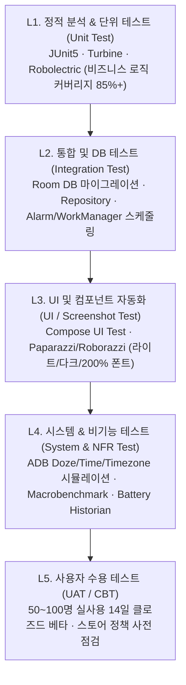

# 오아단 (OADAN) 테스트 계획서 (Master Test Plan)

> **문서 버전:** v1.0 (2026-11-10)
> **참조 문서:**
> - [code_artifact.md](../code_artifact.md) — 요구사항 명세서 (SRS: `FR-01~08`, `NFR-01~09`, 개발 체크리스트)
> - [01_OADAN_기획문서.md](./01_OADAN_기획문서.md) — 서비스 기획서 (`OA-01~06`, 화면 `SC-00~51`, 전면 무료·무광고 정책)
> - [02_OADAN_디자인가이드.md](./02_OADAN_디자인가이드.md) — UI/UX 및 접근성 기준

---

## 1. 테스트 개요 및 목적

### 1.1 목적
본 문서는 간헐적 단식 및 오가닉 보식 가이드 앱 **'오아단(OADAN)'**의 출시 전 품질 보증(QA)을 위한 테스트 범위, 전략, 환경, 케이스, 합격 기준(Exit Criteria)을 정의합니다.

### 1.2 핵심 품질 목표 (Core Quality Goals)
1. **타이머 및 알람의 절대적 신뢰성:** 수십 시간 동안 OS 절전(Doze)·앱 강제 종료·재부팅·타임존 변경 상황에서도 **타이머 오차 0초**, **알림 지연 ±1분 이내** 보장 (`NFR-01~03`)
2. **오프라인 완전 가용성 (Local-First):** 비행기 모드 및 무통신 환경에서 핵심 기능(타이머, 보식 추천·기록, 통계, 백업 파일 생성) **100% 정상 동작** (`NFR-04, 05`)
3. **안전 및 스토어 컴플라이언스 무결성:** 의료기기 면책 고지, 저혈당·어지러움 즉시 중단 안내, 부정적 식단 평가 문구 배제, 데이터 즉시 파기 기능 완벽 준수 (`NFR-06, 07`)
4. **전면 무료·무광고 정책 검증:** 앱 전 구간에서 결제(Paywall)·광고 SDK·추적기가 포함되지 않았음을 보장 (기획서 7장)
5. **저전력·고성능 UX:** Cold Start **1.5초 이내**, 위젯 응답 **0.3초 이내**, 일일 백그라운드 배터리 소모 **1% 미만** 달성 (`NFR-08, 09`)

---

## 2. 테스트 범위 (Test Scope)

### 2.1 릴리스 단계별 범위

| 구분 | 포함 항목 (In-Scope) | 제외 항목 (Out-of-Scope / 후속 릴리스) |
| :--- | :--- | :--- |
| **MVP (v1.0)** | • `FR-01~05` 타이머 코어, 대사 단계, 멀티 트래킹, 스마트 푸시/포기 방어<br>• `OA-01~03` 오가닉 보식 추천(Rule-based), 보식 기록·오가닉 스코어, `#오아단인증` 카드 생성·공유<br>• `FR-06` 기본 캘린더·통계 (`SC-40`)<br>• `NFR-01~09` 전 항목 및 SRS 개발 체크리스트 3대 항목<br>• JSON/CSV 로컬 파일 백업·복원 및 전체 데이터 즉시 삭제 | • 소셜 로그인 및 자체 클라우드 서버 동기화 (v1.2)<br>• `FR-08` 비전 AI 사진 식단 분석 및 Health Connect (v2.0)<br>• `OA-06` 인앱 커뮤니티 피드 (v2.0)<br>• iOS 플랫폼 (v2.0)<br>• 인앱 결제/구독 및 광고 모듈 (영구 제외) |
| **v1.1 확장** | • `FR-06` 오아시스 정원(스트릭 시각화) 및 월 2회 세이버<br>• `FR-07` 홈 위젯(2×2, 4×2), 상단 고정 알림(Ongoing), Wear OS 타일/컴플리케이션<br>• `OA-04` 오가닉 장보기 리스트 | - |

---

## 3. 테스트 전략 및 레벨 (Test Strategy)



| 테스트 레벨 | 대상 | 도구 및 방법 | 목표 기준 |
| :--- | :--- | :--- | :--- |
| **단위 테스트 (Unit)** | 타이머 Delta 계산, 대사 단계 판정, 보식 추천 룰 엔진, 오가닉 스코어 계산, 타임존 보정 로직 | JUnit5, MockK, Kotlinx-coroutines-test | 도메인 로직 커버리지 **90% 이상** |
| **통합 테스트 (Integration)** | Room DB CRUD, JSON/CSV 백업·복원 정합성, AlarmManager 스케줄 등록/취소 | AndroidX Test, Room Testing | 데이터 유실·오염 **0건** |
| **UI/스크린샷 테스트** | 화면 `SC-00~51` 상태 렌더링, 다크 모드, 글꼴 200% 확대, 접근성 Semantics | Compose Test, Roborazzi, Accessibility Checks | 주요 플로우 자동화 **100%** |
| **비기능/시스템 테스트** | Doze 모드 알람, 시계 조작, 배터리 소모, Cold Start 속도, 오프라인 동작 | ADB(`dumpsys deviceidle`), Macrobenchmark, Perfetto | NFR SLA 전 항목 충족 |

---

## 4. 테스트 환경 및 디바이스 매트릭스

### 4.1 타깃 OS 및 디바이스 매트릭스 (Android)

| 구분 | 단말기 (예시) | OS 버전 | 화면 특성 | 선정 사유 |
| :--- | :--- | :--- | :--- | :--- |
| **Tier 1 (주력)** | Galaxy S24 / S23 | Android 14 / 15 (One UI) | 360×780dp, 120Hz | 국내 점유율 최상위, 삼성 자체 절전 정책(딥슬립) 검증 필수 |
| **Tier 1 (주력)** | Pixel 7 / 8 | Android 14 / 15 (순정) | 411×891dp | 순정 Android 기준 동작, Health Connect 및 기본 알람 검증 |
| **Tier 2 (하위 호환)** | Galaxy A32 / A52 | Android 12 (API 31) | 보급형 SoC | **Exact Alarm 권한 정책 변경 기점(API 31)** 및 저사양 Cold Start 검증 |
| **Tier 2 (최소 사양)** | 에뮬레이터 / 구형 단말 | Android 9~11 (API 28~30) | 소형 해상도(320dp 폭) | 작은 화면 레이아웃 깨짐 및 레거시 알람 동작 확인 |
| **Tier 3 (폼팩터)** | Galaxy Z Flip 5 / Fold 5 | Android 14 | 폴더블 / 대화면(Medium) | 화면 접힘·펼침 시 상태 유지 및 8컬럼 반응형 레이아웃 검증 |
| **Tier 3 (웨어러블)** | Galaxy Watch 6 | Wear OS 4+ | 원형 40/44mm | `FR-07` 워치 타일·컴플리케이션 및 수분 추가 동기화 검증 (v1.1) |

### 4.2 시스템 조작 테스트용 ADB 명령어 표준
QA 엔지니어가 수십 시간의 단식을 기다리지 않고 즉시 검증하기 위해 아래 ADB 시뮬레이션 절차를 표준화합니다.

```bash
# 1) Doze 모드(절전) 강제 진입 및 해제 (NFR-02 검증)
adb shell dumpsys battery unplug
adb shell dumpsys deviceidle force-idle
adb shell dumpsys deviceidle step
# 복구: adb shell dumpsys deviceidle unforce && adb shell dumpsys battery reset

# 2) 백그라운드 프로세스 강제 종료 후 복구 검증 (NFR-01 검증)
adb shell am kill com.oadan.app

# 3) 타임존 및 시스템 시간 변경 검증 (NFR-03 검증)
adb shell service call alarm 3 s16 "America/New_York"
```

---

## 5. 요구사항 추적성 및 상세 테스트 케이스

### 5.1 기능 요구사항 테스트 케이스 (Functional Test Cases)

#### A. 온보딩 및 플랜 설정 (`FR-01`, `SC-01~02`)

| TC ID | 관련 요구사항 | 테스트 시나리오 | 사전 조건 | 테스트 절차 | 기대 결과 (Pass 기준) | 우선순위 |
| :--- | :--- | :--- | :--- | :--- | :--- | :---: |
| **TC-FR01-01** | `FR-01`<br>`NFR-05` | 무가입 3탭 첫 단식 시작 | 앱 최초 설치, 네트워크 ON/OFF | 1. 앱 실행(`SC-01`) → [시작하기]<br>2. 플랜 `16:8` 선택(`SC-02`) → [시작하기]<br>3. 면책 동의 후 [공복 시작하기] 탭 | • 회원가입/로그인 강제 화면 없이 3탭·60초 이내 타이머 시작<br>• 각 프리셋 카드에 난이도 바와 '추천 보식 강도'가 일치하게 표시됨 | **P0** |
| **TC-FR01-02** | `FR-01` | 프리셋 6종 및 커스텀(1~72h) 설정 | 플랜 선택 화면 | 1. `14:10`, `16:8`, `18:6`, `20:4`, `OMAD`, `5:2` 각각 선택 확인<br>2. [직접 설정]에서 `0h`, `1h`, `72h`, `73h` 입력 시도 | • `1h~72h` 범위만 허용되고 `0h` 및 `73h` 이상은 입력 차단(경계값 검증)<br>• 설정한 목표 시간이 홈 타이머 목표 종료 시각에 즉시 반영됨 | **P0** |
| **TC-FR01-03** | `FR-01` | 요일별 스케줄 및 시작 방식 분리 | 요일별 스케줄 ON | 1. 평일 `16:8`, 주말 `14:10` 설정<br>2. '알림만 받고 수동 시작' vs '예약 시간 자동 시작' 각각 설정 후 예약 시각 도달 | • 수동 옵션: 알림만 수신되고 타이머는 대기 상태 유지<br>• 자동 옵션: 예약 시각에 백그라운드에서 타이머 자동 시작 | **P1** |

#### B. 오아시스 타이머 및 시간 보정 (`FR-02`, `SC-10~11`, `SC-51`)

| TC ID | 관련 요구사항 | 테스트 시나리오 | 사전 조건 | 테스트 절차 | 기대 결과 (Pass 기준) | 우선순위 |
| :--- | :--- | :--- | :--- | :--- | :--- | :---: |
| **TC-FR02-01** | `FR-02` | 실시간 렌더링 및 일러스트 수위 변화 | `16:8` 단식 진행 중 | 1. 경과율 0%, 25%, 50%, 75%, 100% 시점의 `SC-11` 화면 확인<br>2. 초 단위 숫자 변화 관찰 | • 원형 링 진행률·대사 단계 마커(4·8·12·16h)·내부 오아시스 수위가 경과율에 정확히 비례<br>• 고정폭 숫자(`tabular-nums`) 적용으로 초 변경 시 좌우 흔들림 0px | **P0** |
| **TC-FR02-02** | `FR-02` | 시작·종료 시간 수동 소급 수정 | 단식 진행 중 / 완료 후 | 1. 진행 중 시작 시각을 2시간 전으로 소급 수정<br>2. 완료 후 종료 시각을 30분 전으로 수정<br>3. 미래 시각 또는 시작>종료 역전 시각 입력 시도 | • 시작 시각 소급 시 경과 시간·대사 단계·알람 시각이 즉시 재계산됨<br>• 완료 기록 수정 시 통계·스트릭·보식 추천 단계가 재산출됨<br>• 미래 시각 및 역전 시각 입력 시 유효성 안내 후 저장 차단 | **P0** |
| **TC-FR02-03** | `FR-02` | 목표 도달 후 초과 달성 카운트 | 목표 시간 100% 도달 | 1. 목표 종료 알림 수신 후 종료 버튼을 누르지 않고 2시간 유지 | • 타이머가 멈추지 않고 초과 시간을 계속 카운트<br>• 바깥쪽 `Sunset Coral` 보너스 링(4dp)이 추가 렌더링됨 | **P1** |
| **TC-FR02-04** | 체크리스트 3 | 72시간 이상 비정상 누적 방지 팝업 | 단식 시작 후 72시간 경과 (종료 미실행) | 1. 시작 시각을 73시간 전으로 설정 후 앱 재진입(`SC-51`) | • *"단식이 아직 진행 중인가요? 종료 시간을 수정해 주세요"* 팝업 자동 출력<br>• 종료 시각 보정 전까지 비정상 데이터가 평균 통계에 반영되지 않음 | **P0** |

#### C. 생체 대사 단계 타임라인 (`FR-03`, `SC-12`)

| TC ID | 관련 요구사항 | 테스트 시나리오 | 사전 조건 | 테스트 절차 | 기대 결과 (Pass 기준) | 우선순위 |
| :--- | :--- | :--- | :--- | :--- | :--- | :---: |
| **TC-FR03-01** | `FR-03` | 5단계 전환 경계값 검증 | 단식 진행 중 | 1. 경과 시간 `3h 59m 59s` → `4h 00m 00s` 전환 확인<br>2. 동일하게 `8h`, `12h`, `16h` 경계 시점 확인 | • 각 경계 시각 정각에 🏜️모래(0~4h) → 🌬️바람(4~8h) → 💧샘물(8~12h) → 🌴야자수(12~16h) → ✨오아시스(16h~)로 배지·컬러·설명 즉시 전환<br>• 다음 단계까지 남은 시간 카운트다운 정확히 표시 | **P0** |
| **TC-FR03-02** | `FR-03`<br>`NFR-06` | 과학적 근거 툴팁 및 면책 문구 | `SC-12` 바텀시트 열림 | 1. 상단 단계 배지 탭 → `SC-12` 진입<br>2. [과학적 근거 보기] 탭 | • 케토시스·오토파지 등 정확한 과학 용어와 참고 근거 툴팁 표시<br>• 하단에 *"일반적인 연구 기준이며 개인차가 있어요. 의료적 진단이 아닙니다."* 상시 노출 | **P1** |

#### D. 수분·체중·컨디션 멀티 트래킹 (`FR-04`, `SC-11`, `SC-30`, `SC-51`)

| TC ID | 관련 요구사항 | 테스트 시나리오 | 사전 조건 | 테스트 절차 | 기대 결과 (Pass 기준) | 우선순위 |
| :--- | :--- | :--- | :--- | :--- | :--- | :---: |
| **TC-FR04-01** | `FR-04` | 원터치 수분 기록 및 용량 커스텀 | 홈 화면(`SC-11`) | 1. 우하단 수분 FAB 짧게 탭<br>2. 수분 FAB 길게 탭 → `150 / 250 / 500ml / 직접 입력` 선택 | • 짧게 탭 시 기본 용량 즉시 합산 및 버튼 내 수위 상승 인터랙션 동작<br>• 일일 목표 대비 달성률 정확히 갱신 | **P1** |
| **TC-FR04-02** | `FR-04`<br>`NFR-06` | 위험 컨디션 태그 선택 시 즉시 중단 안내 | 컨디션 기록 화면(`SC-51`) | 1. 컨디션 태그 중 `💫 어지러움` 또는 `🤕 두통` 선택 | • 감성 문구/일러스트가 배제된 **건강 안전 바텀시트(`SC-51`)** 즉시 자동 노출<br>• 1·2·3 응급 행동 지침(휴식·당분 섭취·의료진 상담) 및 **[지금 공복 마치기]** 버튼 최우선 제공 | **P0** |
| **TC-FR04-03** | `FR-04` | 체중·체성분 및 눈바디 타임스탬프 | 기록 탭(`SC-30`) | 1. 체중·골격근량·체지방률 입력<br>2. 눈바디 사진 촬영/선택 저장 | • 입력값 저장 및 리포트 이중축 그래프 반영<br>• 눈바디 사진은 최초 사용 시점에만 카메라/사진 권한 요청(Contextual Permission) 및 촬영 시각 타임스탬프 자동 기록 | **P1** |

#### E. 스마트 푸시 및 중도 포기 방어 (`FR-05`, `SC-13`)

| TC ID | 관련 요구사항 | 테스트 시나리오 | 사전 조건 | 테스트 절차 | 기대 결과 (Pass 기준) | 우선순위 |
| :--- | :--- | :--- | :--- | :--- | :--- | :---: |
| **TC-FR05-01** | `FR-05` | 3종 핵심 알림 발송 | 알림 권한 허용 | 1. 단식 시작 예정 30분 전<br>2. 대사 단계 전환 시점(4/8/12/16h)<br>3. 목표 단식 종료 시점 | • 각 시점에 정확한 문구로 알림 수신<br>• 야간 방해 금지 시간대 설정 시 무음/차단 옵션 정상 작동 | **P0** |
| **TC-FR05-02** | `FR-05` | 중도 포기 방어 모달 및 '부분 달성' 처리 | 목표 미달 상태(예: 16h 목표 중 14h 경과) | 1. [공복 마치기] 탭 → 방어 모달(`SC-13`) 확인<br>2. 선택지 A: [1시간만 더 쉬어가기]<br>3. 선택지 B: [오늘 목표 14시간으로 줄이기]<br>4. 선택지 C: [여기서 마무리하기] | • 모달에 현재 단계·남은 시간 응원 문구 출력<br>• A 선택: 타이머 유지 및 1시간 후 리마인드<br>• B 선택: 오늘 목표 14h로 변경 후 즉시 달성 완료(`SC-14`) 진입<br>• C 선택: **'실패'라는 단어 없이 '부분 달성'**으로 캘린더에 기록되고 경과 시간(14h)에 맞는 보식 추천으로 연결 | **P0** |

#### F. 오가닉 보식 추천·기록·인증 카드 (`OA-01~03`, `SC-14`, `SC-20~23`) — 핵심 차별화

| TC ID | 관련 요구사항 | 테스트 시나리오 | 사전 조건 | 테스트 절차 | 기대 결과 (Pass 기준) | 우선순위 |
| :--- | :--- | :--- | :--- | :--- | :--- | :---: |
| **TC-OA01-01** | `OA-01` | 단식 시간별 4단계 보식 추천 로직 | 단식 종료 완료(`SC-14`) | 1. 경과 시간 `13h` / `16h` / `20h` / `26h`로 각각 단식 종료<br>2. [오늘의 오아시스 한 끼 보기] 탭 → `SC-20` 확인 | • `~14h`: 일반 보식 / `14~18h`: 부드러운 보식 / `18~24h`: 순한 보식 / `24h+`: **회복 보식(1단계 국물·발효식 → 30~60분 후 2단계 일반식)** 정확히 매칭<br>• 먹는 순서 배너(`🥬채소 → 🥚단백질 → 🍠탄수화물`) 및 메뉴 3종 노출 | **P0** |
| **TC-OA01-02** | `OA-01` | 식단 필터 및 알레르기 제외 | `SC-20` 보식 홈 | 1. `비건`, `락토오보`, `글루텐프리`, `저탄수` 필터 전환<br>2. 알레르기(견과·유제품 등) 설정 후 추천 목록 확인 | • 선택한 필터에 부합하고 알레르기 유발 재료가 포함된 레시피는 추천 목록에서 100% 제외됨 | **P1** |
| **TC-OA02-01** | `OA-02` | 오가닉 스코어 산출 및 긍정 피드백 원칙 | `SC-22` 보식 기록 | 1. 체크 항목 5개 중 0개 / 3개 / 5개 선택하여 저장<br>2. 출력되는 등급 및 피드백 문구 확인 | • 점수 구간에 따라 `🌱새싹(0~49)` / `🌿잎새(50~79)` / `🌳오아시스(80~100)` 배지 정확히 부여<br>• 0점을 받더라도 **"나쁜 음식", "실패", "칼로리 과다" 등 부정적·죄책감 유발 문구가 절대 노출되지 않고** 격려 문구로 안내됨 | **P0** |
| **TC-OA03-01** | `OA-03` | `#오아단인증` 카드 생성·프라이버시·공유 | 보식 기록 저장 직후(`SC-23`) | 1. 템플릿 3종(사진형/미니멀/오아시스) 및 비율(`1:1` / `9:16`) 전환<br>2. '체중 변화 표시' 토글 기본값 확인<br>3. [공유하기] 탭 | • 단식 시간·도달 단계·오가닉 등급·스트릭·보식 사진이 깨짐 없이 합성됨<br>• `9:16` 스토리 비율에서 상하 250px 안전 영역 내에 핵심 텍스트 미배치<br>• **'체중 변화 표시'는 기본 OFF(비노출)** 상태<br>• 공유 시 Android Sharesheet 호출 및 클립보드에 `#오아단 #오아단인증` 자동 복사 | **P0** |

#### G. 리포트·스트릭 및 외부 확장 (`FR-06~07`, `SC-40`, v1.1 포함)

| TC ID | 관련 요구사항 | 테스트 시나리오 | 사전 조건 | 테스트 절차 | 기대 결과 (Pass 기준) | 우선순위 |
| :--- | :--- | :--- | :--- | :--- | :--- | :---: |
| **TC-FR06-01** | `FR-06` | 주간/월간 캘린더 및 스트릭 세이버 | 누적 기록 존재 | 1. `SC-40`에서 달성/부분 달성/휴식일 표시 확인<br>2. 연속 7일 달성 후 하루 미기록 발생 시 세이버 동작 확인 | • 색상뿐 아니라 형태(채움 원/옅은 원/점선 원)로 구분되어 색각 이상자도 식별 가능<br>• 월 2회 한도 내에서 스트릭 세이버가 작동해 연속일수 유지 | **P1** |
| **TC-FR07-01** | `FR-07`<br>체크리스트 2 | 홈 위젯(2×2, 4×2) 장시간 프로토콜 렌더링 | 홈 화면에 위젯 배치 | 1. `16:8` 외에 `20:4`, `OMAD(23:1)`, `48시간` 커스텀 단식 시작<br>2. 16시간 경과 시점의 위젯 프로그레스 링 확인 | • 16시간 시점에 100%로 조기 고정되지 않고, **전체 목표 시간 대비 비율**(예: 48h 중 16h = 33.3%)로 정확히 렌더링됨<br>• 위젯 내 수분 `+250` 및 `종료` 버튼 터치 시 0.3초 이내 UI 피드백 반영 | **P1** |

---

### 5.2 비기능 요구사항 테스트 케이스 (Non-Functional Test Cases)

| TC ID | 관련 NFR | 검증 항목 | 테스트 방법 및 절차 | 목표 SLA / 합격 기준 | 우선순위 |
| :--- | :--- | :--- | :--- | :--- | :---: |
| **TC-NFR-01** | `NFR-01` | 타임스탬프 기반 오차 0초 | 1. 단식 시작 후 앱 강제 종료(`am kill`) 및 기기 재부팅<br>2. 12시간 후 앱 실행하여 `현재 시각 - 시작 시각(UTC)`와 화면 표시 시간 비교 | • 스톱워치/서버 기준 시각 대비 타이머 오차 **0초** | **P0** |
| **TC-NFR-02** | `NFR-02` | Doze 모드 알람 정확도 | 1. 단식 종료 10분 전 기기를 ADB로 Deep Doze(`force-idle`) 상태 진입<br>2. 종료 예정 시각에 알람 수신 시각 측정 (삼성 One UI 절전 포함) | • 목표 시각 대비 알림 도달 지연 **±1분 이내** | **P0** |
| **TC-NFR-03** | `NFR-03` | 타임존 변경 및 시계 조작 방어 | 1. 서울(UTC+9)에서 단식 시작 후 5시간 경과<br>2. 기기 타임존을 뉴욕(UTC-5)으로 변경 → 경과 시간 확인<br>3. 시스템 시계를 수동으로 +10시간 앞당김 → 조작 감지 확인 | • 타임존 변경 시 경과 시간 왜곡 **0초 (정합성 100%)**<br>• 수동 시간 조작 시 `elapsedRealtime` 및 UTC 기준으로 비정상 달성 차단 또는 보정 안내 | **P0** |
| **TC-NFR-04** | `NFR-04` | Local-First 오프라인 100% 가용성 | 1. 기기 **비행기 모드 ON** (Wi-Fi/데이터 완전 차단)<br>2. 온보딩 → 단식 시작/종료 → 보식 추천 조회 → 보식 기록 → 인증 카드 이미지 저장 → 리포트 조회 전 과정 수행 | • 네트워크 오류 팝업이나 무한 로딩 없이 전 기능 **100% 정상 동작** | **P0** |
| **TC-NFR-05** | `NFR-05` | 백업·복원 무결성 | 1. 30일치 단식·수분·체중·보식 데이터를 생성 후 JSON/CSV 백업 파일 내보내기<br>2. 앱 데이터 초기화 후 백업 파일 불러오기(복원) | • 복원 전후 레코드 수 및 필드 값 일치율 **100% (유실률 0%)** | **P0** |
| **TC-NFR-06** | `NFR-06` | 스토어 건강 정책 및 면책 고지 | 1. 온보딩(`SC-01`), 대사 단계(`SC-12`), 컨디션(`SC-51`), 설정(`SC-50`) 화면 전수 점검 | • 의료기기 아님 고지, 임산부·당뇨·섭식장애 전문의 상담 권고, 저혈당 중단 안내가 누락 없이 노출<br>• '질병 치료/예방' 등 의료법·스토어 정책 위반 문구 **0건** | **P0** |
| **TC-NFR-07** | `NFR-07`<br>체크리스트 1 | 개인정보 즉시 파기 및 권한 분리 | 1. 앱 최초 실행 시 권한 팝업 발생 여부 확인<br>2. 마이 > [전체 데이터 즉시 삭제] 실행 후 DB·캐시·공유 저장소 잔존 파일 검사 | • 최초 실행 시 일괄 권한 요청 **0건** (기능 사용 시점에 개별 요청)<br>• 삭제 실행 즉시 Room DB, DataStore, 내부 이미지 캐시 **100% 영구 파기** 및 초기 온보딩 상태로 복귀 | **P0** |
| **TC-NFR-08** | `NFR-08` | Cold Start 및 위젯 응답 성능 | 1. Android Macrobenchmark로 Tier 1/Tier 2 단말에서 Cold Start 20회 반복 측정<br>2. 홈 위젯 버튼 탭 → 상태 반영 지연 측정 | • Cold Start P90 **1.5초 이내**<br>• 위젯 터치 응답 **0.3초 이내** | **P1** |
| **TC-NFR-09** | `NFR-09` | 백그라운드 배터리 최적화 | 1. 16시간 단식 진행(위젯 + 상단 고정 알림 활성화, 화면 꺼짐 상태 유지)<br>2. Battery Historian / `dumpsys batterystats`로 오아단 앱 소모량 측정 | • 포그라운드 외에는 초 단위 갱신이 중단되고 분 단위만 갱신됨<br>• 24시간 기준 백그라운드 배터리 소모율 **1% 미만** | **P1** |
| **TC-FREE-01** | 기획서 7장 | 전면 무료·무광고 무결성 검증 | 1. APK 디컴파일/의존성 분석으로 결제(Billing)·광고(AdMob 등) SDK 및 불필요 네트워크 권한 포함 여부 검사<br>2. 전 화면 탐색 시 잠금 아이콘·결제 유도 팝업 유무 확인 | • 결제/광고 SDK **0건**, 기능 잠금(Paywall) **0건** | **P0** |

---

## 6. 디자인 · 접근성 · UX 라이팅 품질 체크리스트

[02_OADAN_디자인가이드.md](./02_OADAN_디자인가이드.md) 준수 여부를 확인하기 위한 QA 체크리스트입니다.

- [ ] **고정폭 숫자(`tnum`):** 타이머(`14:24:08`)가 매초 바뀔 때 텍스트 박스가 좌우로 1px도 흔들리지 않는가?
- [ ] **명도 대비 (WCAG 2.1 AA):** 본문 텍스트 대비 4.5:1 이상이며, 특히 `Sunset Coral(#E8875B)` 버튼 위 텍스트에 흰색 대신 `Deep Ink(#1E2A28)`가 적용되었는가?
- [ ] **색각 이상 대응:** 대사 단계 5종과 리포트 캘린더(달성/부분 달성/휴식)가 색상 외에 아이콘·형태(채움/점선)로도 명확히 구분되는가?
- [ ] **TalkBack 스크린 리더:** 타이머 포커스 시 매초 읽지 않고 1분 단위로 *"단식 14시간 24분 경과, 목표까지 1시간 35분, 케토시스 단계"*처럼 의미 있는 문장으로 안내하는가? 장식용 일러스트에 `importantForAccessibility="no"`가 지정되었는가?
- [ ] **시스템 폰트 200% 및 애니메이션 제거:** OS 설정에서 글자 크기 200% 확대 시 텍스트 잘림·버튼 겹침이 없으며, '애니메이션 제거' 활성화 시 물방울/Lottie 모션이 150ms 페이드로 대체되는가?
- [ ] **UX 라이팅 금지어 점검:** 앱 전체 문자열(`strings.xml`)에 `"단식 실패"`, `"나쁜 음식"`, `"칼로리 과다"`, `"절대 먹지 마세요"` 등 죄책감·섭식장애를 유발하는 표현이 **0건**인가?

---

## 7. 결함 관리 및 심각도 기준 (Defect Triage)

| 등급 | 정의 | 예시 | 조치 기한 |
| :--- | :--- | :--- | :--- |
| **S1 — Critical (Blocker)** | 앱 크래시/ANR, 데이터 유실, 타이머/알람 오동작, 건강 안전 안내 미노출, 스토어 정책 위반 | • Doze 모드에서 종료 알림 미발송<br>• 72시간 초과 방치 시 통계 오염<br>• 어지러움 선택 시 안전 모달 미노출<br>• 데이터 삭제 후 DB 잔존 | **즉시 수정 (출시 불가)** |
| **S2 — Major** | 주요 기능 오작동 또는 우회 경로 없음, NFR 목표 수치 미달 | • 단식 시간별 보식 추천 단계 오매칭<br>• 인증 카드 공유 실패 또는 체중 기본 노출<br>• Cold Start 1.5초 초과 / 배터리 1% 초과 | **릴리스 전 필수 수정** |
| **S3 — Minor** | 기능은 동작하나 UI 깨짐·문구 오타·다크 모드 일부 색상 누락 | • 200% 폰트에서 칩 줄바꿈 어색함<br>• 특정 해상도에서 일러스트 여백 오차 | 핫픽스 또는 차기 버전(v1.1) 반영 |
| **S4 — Trivial** | 사용성에 영향 없는 미세 개선 제안 | • 모션 Easing 미세 조정 의견 | 백로그 등록 |

---

## 8. 테스트 일정 및 출시 승인 기준 (Schedule & Exit Criteria)

### 8.1 단계별 테스트 일정 (총 4주 — MVP 개발 후반 2주 + CBT 2주)

| 주차 | 단계 | 주요 활동 | 산출물 |
| :---: | :--- | :--- | :--- |
| **W1** | 단위·통합·자동화 구축 | • 도메인/DB 단위 테스트 및 Compose UI 테스트 작성<br>• CI 파이프라인(PR마다 Unit + Lint + Roborazzi 자동 실행) 구축 | 자동화 테스트 스위트 |
| **W2** | 시스템·비기능 집중 QA | • Tier 1~3 실단말 기능 전수 테스트 (`TC-FR`, `TC-OA`)<br>• ADB Doze·타임존·배터리·Cold Start 측정 (`TC-NFR`) | 1차 QA 결과 보고서 및 결함 리포트 |
| **W3** | CBT (클로즈드 베타 1주차) | • 외부 테스터 50~100명 배포 (Google Play 비공개 테스트 트랙)<br>• 실생활 7일 연속 단식·보식 기록·인증 공유 트래킹 | 크래시 로그(Crashlytics 0건 확인), CBT 중간 피드백 |
| **W4** | CBT 2주차 & 리그레션 | • S1/S2 결함 수정 검증 및 전수 회귀 테스트(Regression)<br>• Play Console 데이터 안전(Data Safety)·건강 앱 선언서 최종 점검 | 최종 출시 승인서 (Sign-off) |

### 8.2 최종 출시 승인 기준 (Release Exit Criteria)
아래 6가지 조건을 **모두 충족**해야 v1.0 정식 출시를 승인합니다.

1. **테스트 수행률:** 계획된 `P0`, `P1` 테스트 케이스 **100% 수행 완료**
2. **결함 잔존율:** **S1(Critical) 0건, S2(Major) 0건** (S3 이하는 알려진 이슈로 문서화 후 이관 가능)
3. **자동화 커버리지:** 타이머·대사 단계·보식 추천·오가닉 스코어 도메인 로직 단위 테스트 커버리지 **90% 이상**
4. **비기능 SLA 달성:** 타이머 오차 **0초**, Doze 알림 오차 **±1분 이내**, Cold Start **1.5초 이내**, 일일 백그라운드 배터리 **1% 미만** 실측 통과
5. **CBT 안정성:** 2주간 CBT 기간 중 **Crash-free 세션 99.7% 이상**, ANR 발생률 **0.1% 미만**
6. **컴플라이언스 & 무료 정책:** 스토어 건강/데이터 안전 체크리스트 및 전면 무료·무광고 검증 항목 **100% 적합 판정**
